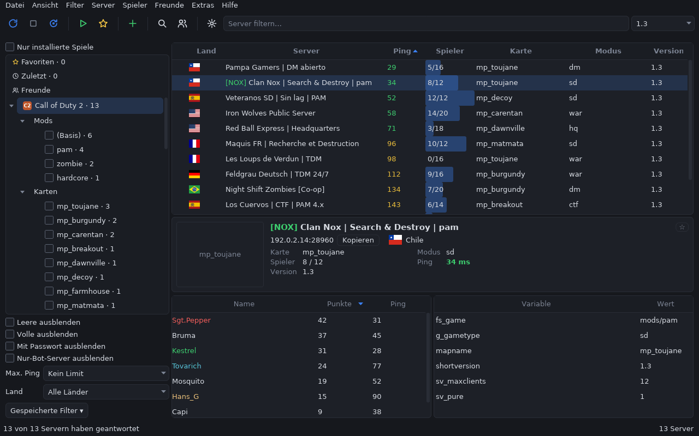
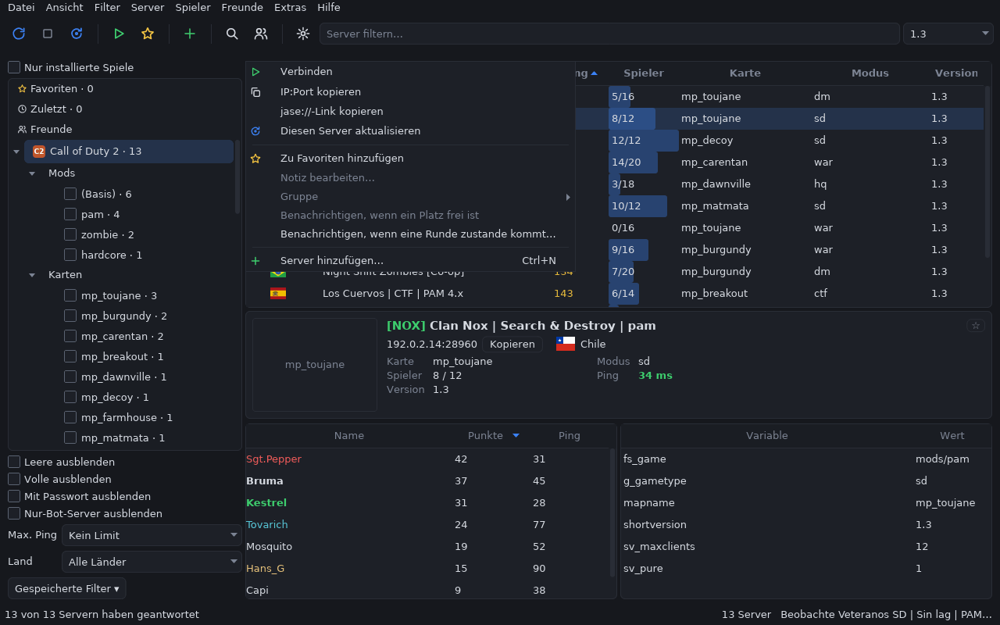
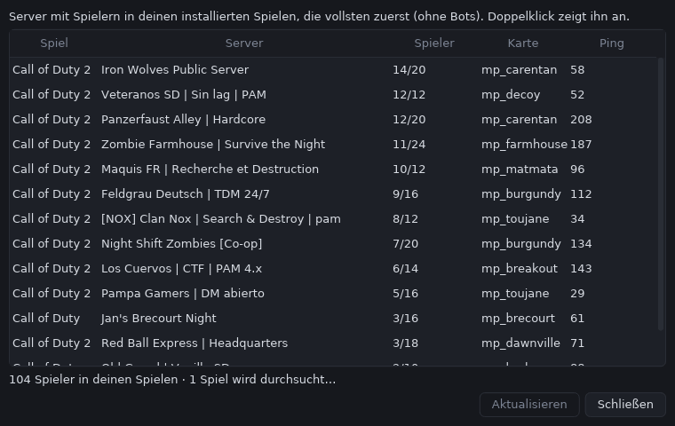
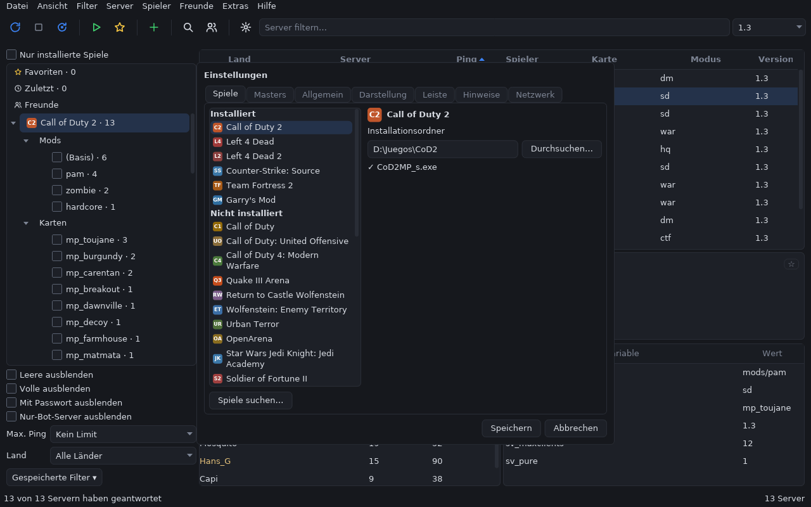
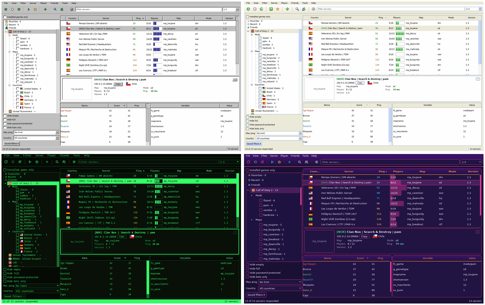

[English](README.md) | [Español](README.es.md) | [Português](README.pt.md) | [Français](README.fr.md) | **Deutsch** | [Italiano](README.it.md)

# Jimmy's All Seeing Eye

**Finde einen Server für die Klassiker, die du immer noch liebst, und tritt mit einem Doppelklick bei.**

JASE ist ein kostenloser Server-Browser für Windows im Geist des alten *All-Seeing Eye*. Spiel auswählen, sehen, wer gerade spielt, und los: keine Konsolenbefehle, kein IP-Kopieren.

**[⬇ Für Windows herunterladen](https://github.com/JotaJazz/JASE/releases)** · kostenlos und Open Source (MIT) · Linux-AppImage (experimentell)

## Was es kann

- 🎮 **36 Klassiker an einem Ort**: Call of Duty, Quake, Unreal Tournament, Counter-Strike, Medal of Honor, Battlefield 1942 und viele mehr.
- ⚡ **Doppelklick zum Spielen**: JASE findet deine installierten Spiele und startet sie direkt verbunden.
- 🔎 **Schnell den richtigen Server finden**: nach Ping, Land, Karte oder Mod filtern; leere, volle oder Nur-Bot-Server ausblenden.
- ⭐ **Favoriten und zuletzt besuchte Server**, mit Gruppen und Notizen, damit der Server deines Clans immer einen Klick entfernt ist.
- 🎨 **Elf Themes**, von Klassisch 98 und Windows XP bis Terminal und Synthwave; auf Deutsch, Englisch, Spanisch, Portugiesisch, Französisch und Italienisch.

## Mehr als das alte ASE

- 🔗 **jase://-Links**: Rechtsklick auf einen Server → *jase://-Link kopieren* und in Discord oder einem Forum einfügen. Wer ihn öffnet, sieht JASE den Server abfragen und fragen, ob er beitreten will.
- 📋 **Einfach einfügen**: `Strg+V` mit einer Adresse, einer Liste oder einem Stück Chat, und JASE fügt alle Server hinzu; *Erkennen* findet heraus, zu welchem Spiel sie gehören.
- 🔔 **Es sagt dir, wann es losgeht**: ein freier Platz auf einem vollen Server, eine Runde, die sich füllt, ein Freund, der online kommt.
- 👥 **Jetzt wird gespielt**: eine Liste mit allen belebten Servern all deiner Spiele, die vollsten zuerst.
- 🧑‍🤝‍🧑 **Freunde und Spielersuche**: einen Spieler in den geladenen Listen suchen; Freunde erscheinen fett.
- 📈 **Auslastungsverlauf**: Favoriten und zuletzt besuchte Server zeigen die durchschnittlichen Spieler pro Stunde.
- 🛠 **Für Admins**: eine RCON-Konsole mit Verlauf.
- 🏠 **LAN-Partys**: findet Server in deinem lokalen Netzwerk ohne Master.
- ⚙️ **Wie du willst**: Symbolleiste umsortieren, Hinweise auswählen, einen HTTP- oder SOCKS-Proxy nutzen.
- 💻 **Kommandozeile**: `jase-cli` macht dieselben Abfragen mit JSON-Ausgabe.
- 🔄 **Immer aktuell**: es aktualisiert sich selbst, und neue Master kommen ohne neue Version an.

<table>
<tr>
<td></td>
<td></td>
</tr>
<tr>
<td></td>
<td></td>
</tr>
</table>

## Unterstützte Spiele

| Familie | Spiele |
|---|---|
| Call of Duty | Call of Duty, Call of Duty: United Offensive, Call of Duty 2, Call of Duty 4: Modern Warfare |
| id Tech / Quake | Quake II, Quake III Arena, Return to Castle Wolfenstein, Wolfenstein: Enemy Territory, Star Wars Jedi Knight II: Jedi Outcast, Star Wars Jedi Knight: Jedi Academy, Soldier of Fortune II, D-Day: Normandy |
| Frei und Community | Urban Terror, OpenArena, Xonotic, Warsow, Warfork, Tremulous, Smokin' Guns, Zandronum (Doom) |
| Unreal | Unreal Tournament (UT99), Tactical Ops, Unreal Tournament 2004 |
| Weitere | Medal of Honor: Allied Assault, Medal of Honor: Spearhead, Medal of Honor: Breakthrough (auch OpenMoHAA), Battlefield 1942 |
| Valve | Counter-Strike 1.6, Half-Life Deathmatch, Day of Defeat, Team Fortress Classic, Counter-Strike: Source\*, Team Fortress 2\*, Left 4 Dead\*, Left 4 Dead 2\*, Garry's Mod\* |

\* Benötigt einen kostenlosen [Steam-Web-API-Schlüssel](docs/guia/user-guide.md#steam-games-and-the-steam-web-api-key) (auf Englisch; auch HL DM, DoD und TFC).

## Bring dein Spiel oder deinen Master mit

Fehlt dein Spiel, oder betreibt deine Community einen eigenen Master-Server? Hilf uns, ihn aufzunehmen:

- **Ein Master**: eröffne ein [Issue](https://github.com/JotaJazz/JASE/issues) mit dem Spiel und `Host:Port` des Masters. Sobald er auf eine echte Abfrage antwortet, kommt er in [`masters.json`](masters.json), und jedes JASE erhält ihn innerhalb eines Tages, ohne neue Version. Bis dahin kannst du ihn selbst unter *Extras → Einstellungen → Masters* hinzufügen.
- **Ein Spiel**: eröffne ein [Issue](https://github.com/JotaJazz/JASE/issues) mit dem Namen, dem verwendeten Master und einem Server zum Testen. Wenn du programmierst, zeigt die [Schritt-für-Schritt-Anleitung](docs/desarrollo/agregar-juego.md) (auf Spanisch), was ein Pull Request braucht: eine echte Abfrage, aufgezeichnete Antworten und Tests.

## Los geht's

1. **Lade** den Installer (`JASE-<Version>-setup.exe`) von [Releases](https://github.com/JotaJazz/JASE/releases) herunter. Lieber ohne Installation? Nimm die portable `.zip`.
2. **Starte ihn.** Windows warnt eventuell, weil die App nicht signiert ist: klicke auf **Weitere Informationen → Trotzdem ausführen**.
3. **Lass es beim ersten Start deine Spiele finden** (oder wähle die Ordner unter *Extras → Einstellungen*).
4. **Spiel auswählen, `F5` drücken, Server doppelklicken.** Fertig.

## Mehr erfahren

- 📖 [Benutzerhandbuch](docs/guia/user-guide.md) (auf Englisch): alle Funktionen, Tastenkürzel, Einstellungen und wo deine Daten liegen.
- 🛰 [Spiele und Master](docs/guia/games-and-masters.md) (auf Englisch): welche Master-Server jedes Spiel nutzt, Versionen und Hinweise pro Spiel.
- 💻 [Kommandozeile (`jase-cli`)](docs/cli.md): dieselben Abfragen ohne Oberfläche, mit JSON-Ausgabe.
- 🛠 [Aus dem Quellcode starten und mitmachen](docs/README.md) (auf Spanisch).

## Über

Ich baue JASE aus Nostalgie für die alten Spiele und die Server, auf denen wir gespielt haben. Ein großer Teil von Code, Tests und Doku entsteht mit [Claude Code](https://claude.com/claude-code), dem KI-Programmierassistenten von Anthropic; ich prüfe, probiere aus und entscheide, was hineinkommt.

MIT-Lizenz; siehe [LICENSE](LICENSE). Länderdaten von [DB-IP](https://db-ip.com) (CC BY 4.0), Flaggen von [flag-icons](https://github.com/lipis/flag-icons) (MIT), gebaut mit Iced, tokio und den Crates in `licenses/THIRD-PARTY.txt`. Menüaufbau inspiriert von OpenASE. Danke an die Communitys, die diese Spiele am Leben halten: 333networks, OpenSpy, jkhub, 1fxmod, dpmaster und cs16.net.
