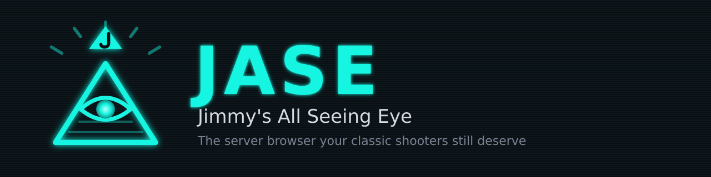
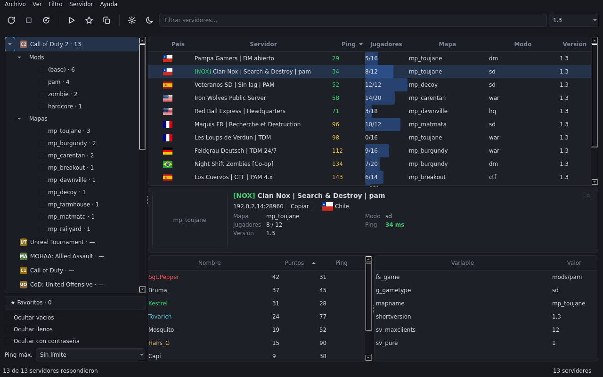

**Español** | [English](README.md)

# Jimmy's All Seeing Eye

**Encuentra servidor para esos juegos clásicos que sigues queriendo, y entra con doble clic.**

JASE es un navegador de servidores gratuito para Windows, al estilo del viejo *All-Seeing Eye*. Elige un juego, mira quién está jugando ahora y entra: sin comandos de consola ni copiar IPs.

**[⬇ Descargar para Windows](https://github.com/JotaJazz/JASE/releases)** · gratis y de código abierto (MIT)

## Qué hace

- 🎮 **36 juegos clásicos en un solo lugar**: Call of Duty, Quake, Unreal Tournament, Counter-Strike, Medal of Honor, Battlefield 1942 y muchos más.
- ⚡ **Doble clic y a jugar**: JASE encuentra tus juegos instalados y los abre ya conectados.
- 🔎 **Encuentra el servidor justo**: filtra por ping, país, mapa o mod; oculta los vacíos, los llenos o los que solo tienen bots.
- ⭐ **Favoritos y recientes**, con grupos y notas, para tener el servidor de tu clan siempre a un clic.
- 🔔 **Avisos** cuando se libera un cupo en un servidor lleno, cuando una partida se está llenando o cuando entra un amigo.
- 👥 **Jugando ahora**: una sola lista con los servidores con gente de todos tus juegos.
- 🏠 **LAN parties**: encuentra los servidores de tu red local.
- 🎨 **Once temas**, de Clásico 98 y Windows XP a Terminal y Synthwave; en español, inglés, portugués, francés, alemán e italiano.

## Juegos soportados

| Familia | Juegos |
|---|---|
| Call of Duty | Call of Duty, Call of Duty: United Offensive, Call of Duty 2, Call of Duty 4: Modern Warfare |
| id Tech / Quake | Quake II, Quake III Arena, Return to Castle Wolfenstein, Wolfenstein: Enemy Territory, Star Wars Jedi Knight II: Jedi Outcast, Star Wars Jedi Knight: Jedi Academy, Soldier of Fortune II, D-Day: Normandy |
| Libres y de la comunidad | Urban Terror, OpenArena, Xonotic, Warsow, Warfork, Tremulous, Smokin' Guns, Zandronum (Doom) |
| Unreal | Unreal Tournament (UT99), Tactical Ops, Unreal Tournament 2004 |
| Otros | Medal of Honor: Allied Assault, Medal of Honor: Spearhead, Medal of Honor: Breakthrough (también OpenMoHAA), Battlefield 1942 |
| Valve | Counter-Strike 1.6, Half-Life Deathmatch, Day of Defeat, Team Fortress Classic, Counter-Strike: Source\*, Team Fortress 2\*, Left 4 Dead\*, Left 4 Dead 2\*, Garry's Mod\* |

\* Necesita una [clave gratuita de la API web de Steam](docs/guia/guia-usuario.md#juegos-de-steam-y-la-clave-de-la-api-web-de-steam) (también HL DM, DoD y TFC).

¿Falta tu juego? [Abre un issue](https://github.com/JotaJazz/JASE/issues).

## Empezar

1. **Descarga** el instalador (`JASE-<versión>-setup.exe`) desde [Releases](https://github.com/JotaJazz/JASE/releases). ¿Prefieres no instalar? Baja el `.zip` portátil.
2. **Ábrelo.** Windows puede avisar porque la app no está firmada: pulsa **Más información → Ejecutar de todas formas**.
3. **Deja que encuentre tus juegos** en el primer arranque (o indica las carpetas en *Archivo → Ajustes*).
4. **Elige un juego, pulsa `F5` y haz doble clic en un servidor.** Eso es todo.

JASE te avisa cuando sale una versión nueva y puede actualizarse solo.

## Más información

- 📖 [Guía de uso](docs/guia/guia-usuario.md): todas las funciones, atajos, ajustes y dónde se guardan tus datos.
- 🛰 [Juegos y masters](docs/guia/juegos-y-masters.md): qué masters usa cada juego, versiones y notas por juego.
- 💻 [Línea de comandos (`jase-cli`)](docs/cli.md): las mismas consultas sin interfaz, con salida JSON (en inglés).
- 🛠 [Ejecutar desde el código y colaborar](docs/README.md).

## Sobre el proyecto

Hago JASE por nostalgia de los juegos de antes y de los servidores donde jugábamos. Buena parte del código, los tests y la documentación se escribe con [Claude Code](https://claude.com/claude-code), el asistente de programación con IA de Anthropic; yo reviso, pruebo y decido qué entra.

Licencia MIT; ver [LICENSE](LICENSE). Datos de país de [DB-IP](https://db-ip.com) (CC BY 4.0), banderas de [flag-icons](https://github.com/lipis/flag-icons) (MIT), hecho con PySide6, keyring y Pillow. Gracias a las comunidades que mantienen vivos estos juegos: 333networks, OpenSpy, jkhub, 1fxmod, dpmaster y cs16.net.
