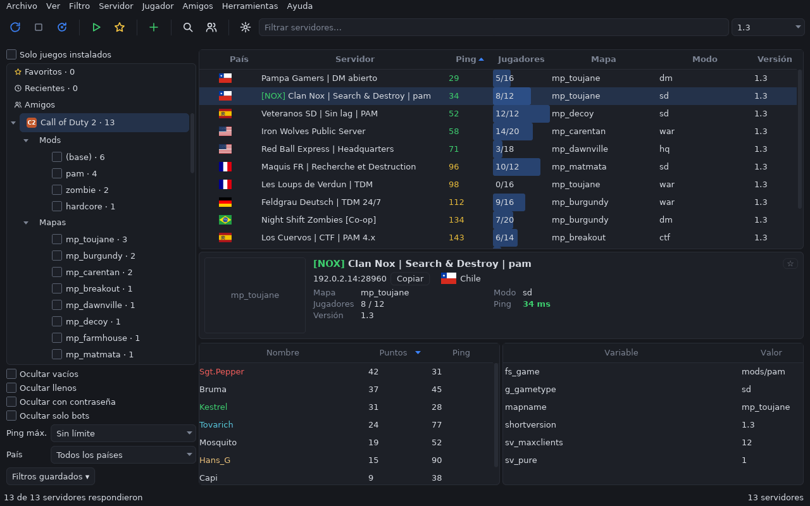
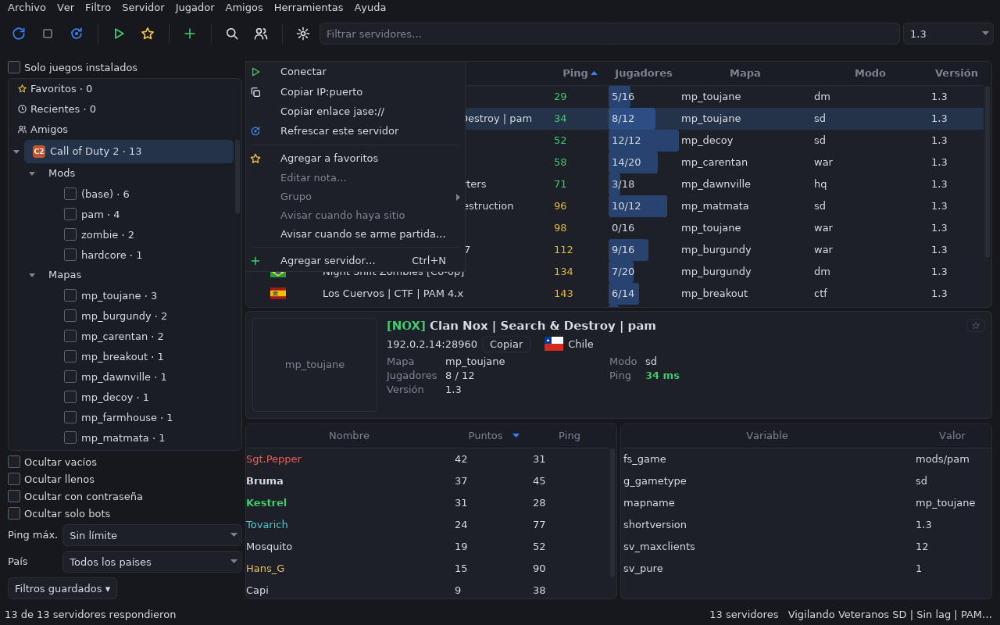
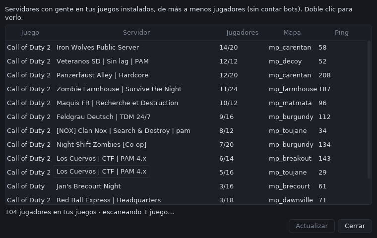
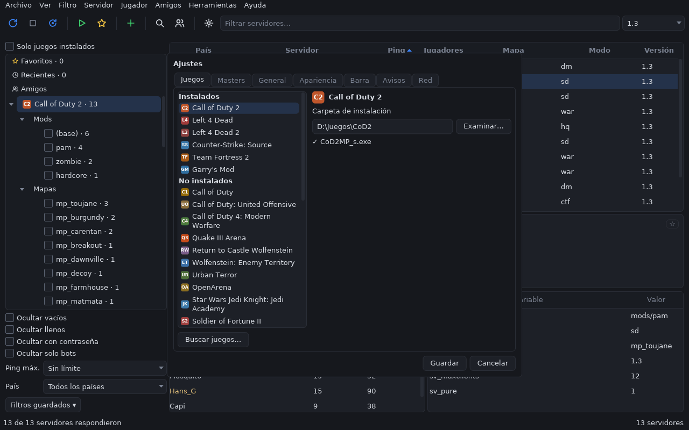

[English](README.md) | **Español** | [Português](README.pt.md) | [Français](README.fr.md) | [Deutsch](README.de.md) | [Italiano](README.it.md)

# Jimmy's All Seeing Eye

**Encuentra servidor para los juegos clásicos que sigues queriendo, y entra con doble clic.**

JASE es un navegador de servidores gratuito para Windows al estilo del viejo *All-Seeing Eye*. Elige un juego, mira quién está jugando ahora mismo y entra: sin comandos de consola ni IPs copiadas a mano.

**[⬇ Descargar para Windows](https://github.com/JotaJazz/JASE/releases)** · gratis y de código abierto (MIT) · AppImage para Linux (experimental)

## Qué hace

- 🎮 **36 juegos clásicos en un solo lugar**: Call of Duty, Quake, Unreal Tournament, Counter-Strike, Medal of Honor, Battlefield 1942 y muchos más.
- ⚡ **Doble clic para jugar**: JASE encuentra tus juegos instalados y los abre ya conectados.
- 🔎 **Encuentra rápido el servidor justo**: filtra por ping, país, mapa o mod; oculta los vacíos, los llenos o los que solo tienen bots.
- ⭐ **Favoritos y servidores recientes**, con grupos y notas, para tener el servidor de tu clan siempre a un clic.
- 🎨 **Once temas**, de Clásico 98 y Windows XP a Terminal y Synthwave; en español, inglés, portugués, francés, alemán e italiano.

## Más que el viejo ASE

- 🔗 **Enlaces jase://**: clic derecho en un servidor → *Copiar enlace jase://* y pégalo en Discord o en un foro. Quien lo abre ve a JASE consultar ese servidor y preguntar si quiere entrar.
- 📋 **Pega lo que sea**: `Ctrl+V` con una dirección, una lista o un trozo de chat, y JASE agrega todos los servidores; *Detectar* averigua de qué juego son.
- 🔔 **Te avisa cuándo jugar**: un hueco en un servidor lleno, una partida que se llena, un amigo que se conecta.
- 👥 **Ahora se juega**: una lista con todos los servidores con gente de todos tus juegos, los más llenos primero.
- 🧑‍🤝‍🧑 **Amigos y búsqueda de jugadores**: busca a un jugador en las listas cargadas; tus amigos salen en negrita.
- 📈 **Historial de ocupación**: favoritos y recientes muestran sus jugadores promedio por hora.
- 🛠 **Para administradores**: una consola RCON con historial.
- 🏠 **LAN parties**: encuentra servidores de tu red local sin master.
- ⚙️ **A tu manera**: ordena la barra de herramientas, elige tus avisos, usa un proxy HTTP o SOCKS.
- 💻 **Línea de comandos**: `jase-cli` hace las mismas consultas con salida JSON.
- 🔄 **Siempre al día**: se actualiza sola, y los masters nuevos te llegan sin versión nueva.

<table>
<tr>
<td></td>
<td></td>
</tr>
<tr>
<td></td>
<td></td>
</tr>
</table>

## Juegos soportados

| Familia | Juegos |
|---|---|
| Call of Duty | Call of Duty, Call of Duty: United Offensive, Call of Duty 2, Call of Duty 4: Modern Warfare |
| id Tech / Quake | Quake II, Quake III Arena, Return to Castle Wolfenstein, Wolfenstein: Enemy Territory, Star Wars Jedi Knight II: Jedi Outcast, Star Wars Jedi Knight: Jedi Academy, Soldier of Fortune II, D-Day: Normandy |
| Libres y comunitarios | Urban Terror, OpenArena, Xonotic, Warsow, Warfork, Tremulous, Smokin' Guns, Zandronum (Doom) |
| Unreal | Unreal Tournament (UT99), Tactical Ops, Unreal Tournament 2004 |
| Otros | Medal of Honor: Allied Assault, Medal of Honor: Spearhead, Medal of Honor: Breakthrough (también OpenMoHAA), Battlefield 1942 |
| Valve | Counter-Strike 1.6, Half-Life Deathmatch, Day of Defeat, Team Fortress Classic, Counter-Strike: Source\*, Team Fortress 2\*, Left 4 Dead\*, Left 4 Dead 2\*, Garry's Mod\* |

\* Necesita una [clave gratuita de la API web de Steam](docs/guia/guia-usuario.md#juegos-de-steam-y-la-clave-de-la-api-web-de-steam) (también HL DM, DoD y TFC).

## Trae tu juego o tu master

¿Falta tu juego, o tu comunidad tiene su propio servidor master? Ayúdanos a sumarlo:

- **Un master**: abre un [issue](https://github.com/JotaJazz/JASE/issues) con el juego y el `host:puerto` del master. Cuando responde a un sondeo real entra en [`masters.json`](masters.json), y todas las copias de JASE lo reciben en menos de un día, sin versión nueva. Mientras tanto puedes agregarlo tú en *Herramientas → Ajustes → Masters*.
- **Un juego**: abre un [issue](https://github.com/JotaJazz/JASE/issues) con su nombre, el master que usa y un servidor para probar. Si programas, la [guía paso a paso](docs/desarrollo/agregar-juego.md) explica qué necesita un pull request: un sondeo real, respuestas grabadas y tests.

## Para empezar

1. **Descarga** el instalador (`JASE-<versión>-setup.exe`) desde [Releases](https://github.com/JotaJazz/JASE/releases). ¿Prefieres no instalar? Baja el `.zip` portátil.
2. **Ábrelo.** Windows puede avisarte porque la app no está firmada: pulsa **Más información → Ejecutar de todas formas**.
3. **Deja que encuentre tus juegos** la primera vez (o elige las carpetas en *Herramientas → Ajustes*).
4. **Elige un juego, pulsa `F5` y haz doble clic en un servidor.** Eso es todo.

## Más información

- 📖 [Guía de uso](docs/guia/guia-usuario.md): todas las funciones, atajos, ajustes y dónde se guardan tus datos.
- 🛰 [Juegos y masters](docs/guia/juegos-y-masters.md): qué servidores master usa cada juego, versiones y notas por juego.
- 💻 [Línea de comandos (`jase-cli`)](docs/cli.md): las mismas consultas sin interfaz, con salida JSON.
- 🛠 [Ejecutar desde el código y colaborar](docs/README.md).

## Acerca de

Hago JASE por nostalgia de los juegos de antes y de los servidores donde jugábamos. Buena parte del código, los tests y la documentación se escriben con [Claude Code](https://claude.com/claude-code), el asistente de programación con IA de Anthropic; yo reviso, pruebo y decido qué entra.

Licencia MIT; ver [LICENSE](LICENSE). Datos de países de [DB-IP](https://db-ip.com) (CC BY 4.0), banderas de [flag-icons](https://github.com/lipis/flag-icons) (MIT), hecho con Iced, tokio y los crates de `licenses/THIRD-PARTY.txt`. Disposición de menús inspirada en OpenASE. Gracias a las comunidades que mantienen vivos estos juegos: 333networks, OpenSpy, jkhub, 1fxmod, dpmaster y cs16.net.
