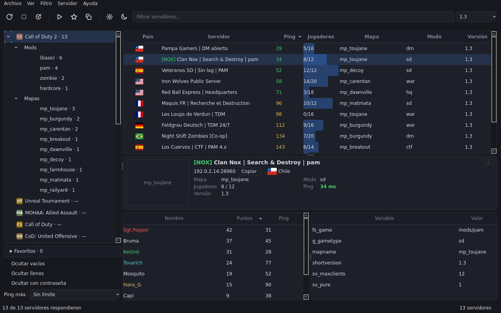

**Español** | [English](README.md)


# Jimmy's All Seeing Eye (JASE)

Navegador de servidores de juego al estilo del clásico *All-Seeing Eye*. Consulta los masters, muestra los servidores con nombre, mapa, jugadores, versión y ping, y abre el juego ya conectado con doble clic.



## Características

- 34 juegos soportados (Medal of Honor cuenta Spearhead y Breakthrough por separado) en cinco protocolos: Quake 2 (Quake II, D-Day: Normandy), Quake 3 (Call of Duty, Quake III, Wolfenstein, Jedi Outcast, Jedi Academy, SoF2, Urban Terror, OpenArena, Xonotic, Warsow, Warfork, Tremulous, Smokin' Guns), GameSpy (Unreal Tournament, Medal of Honor, Battlefield 1942), Valve (Counter-Strike 1.6; además, por la API web de Steam, Left 4 Dead, Left 4 Dead 2, Counter-Strike: Source, Team Fortress 2, Half-Life Deathmatch, Day of Defeat, Team Fortress Classic y Garry's Mod) y UT2004 (Unreal Tournament 2004).
- Tabla de servidores con banderas de país; ficha del servidor con imagen del mapa (de tus juegos instalados, descarga en línea opcional), jugadores y reglas.
- Filtros rápidos (ocultar vacíos, llenos, con contraseña, solo bots, ping máximo, país), más filtros de texto y de versión.
- Árbol de juegos con **Mods** y **Mapas** que se marcan para filtrar la tabla.
- Favoritos, consultados directamente sin master.
- Detección automática de juegos: registro de Windows, bibliotecas de Steam y carpetas típicas.
- Contraseñas de servidores guardadas en el Administrador de credenciales de Windows.
- Once temas (Oscuro, Claro, Neón, Marrón, Verde, Clásico 98, Windows XP, Terminal, Synthwave, Óxido, GoldSrc) más Sistema, en **Ver → Tema** o *Ajustes → Apariencia* (Terminal con fósforo verde, blanco, sepia o ámbar), aplicados al instante; interfaz en español, inglés, portugués, francés, alemán e italiano.

## Juegos soportados

Call of Duty 2, Call of Duty, Call of Duty: United Offensive, Call of Duty 4: Modern Warfare, Quake III Arena, Return to Castle Wolfenstein, Wolfenstein: Enemy Territory, Unreal Tournament (UT99), Medal of Honor: Allied Assault (con Spearhead y Breakthrough, también OpenMoHAA), Star Wars Jedi Knight II: Jedi Outcast, Star Wars Jedi Knight: Jedi Academy, Soldier of Fortune II, Urban Terror, OpenArena, Xonotic, Warsow, Warfork, Tremulous, Smokin' Guns, Counter-Strike 1.6, Battlefield 1942, Quake II, D-Day: Normandy (mod de Quake II), Unreal Tournament 2004, Left 4 Dead, Left 4 Dead 2, Counter-Strike: Source, Team Fortress 2, Half-Life Deathmatch, Day of Defeat, Team Fortress Classic y Garry's Mod (los de Steam necesitan una clave de la API web de Steam).

Masters verificados el 2026-10-18/19, y la API web de Steam y los masters de UT2004 el 2026-10-20; detalle en [Masters usados](#masters-usados).
Half-Life Deathmatch, Day of Defeat y Team Fortress Classic se listan por la API web de Steam (sondeo del 2026-10-20), y también Garry's Mod (sondeo del 2026-10-25: 1064 servidores no vacíos).
Los ejecutables y argumentos de conexión (`+connect`) de Jedi Academy, SoF2, CS 1.6, BF1942, Jedi Outcast, Xonotic, Warsow, Warfork, Tremulous y Smokin' Guns, y los de D-Day (`+set game dday`), están pendientes de verificar en Windows.

## Descarga

Descarga la última versión desde la [página de Releases](https://github.com/JotaJazz/JASE/releases). JASE consulta GitHub como mucho una vez al día (al abrir y luego cada hora) y muestra un enlace en la barra de estado cuando hay una versión más nueva (se desactiva en Ajustes → General); ver [Actualizar desde la app](#actualizar-desde-la-app). Hay dos descargas:

- **Instalador** (`JASE-<versión>-setup.exe`, recomendado): crea un acceso directo en el menú Inicio (el del escritorio es opcional) y un desinstalador en *Configuración → Aplicaciones*. Se instala solo para ti sin permisos de administrador, o para todos los usuarios si lo eliges.
- **Zip portátil** (`JASE-<versión>-win64.zip`): sin instalación; descomprímelo donde quieras y ejecuta `JASE.exe`.

En ambos casos la configuración se guarda en `%APPDATA%\JimmysASE` y desinstalar no la borra.

Ni el instalador ni el exe están firmados, así que Windows SmartScreen puede mostrar un aviso la primera vez. Pulsa **Más información → Ejecutar de todas formas**.

## Uso

En el primer arranque JASE ofrece buscar los juegos instalados. También puedes abrir **Archivo → Ajustes** e indicar a mano la carpeta de cada juego (la que contiene, según el juego: `CoD2MP_s.exe` en CoD2, `CoDMP.exe` en CoD, `CoDUOMP.exe` en United Offensive, `iw3mp.exe` en CoD4, `quake3.exe` en Quake III, `WolfMP.exe` en RtCW, `ET.exe` en Enemy Territory, `System\UnrealTournament.exe` en UT99, `MOHAA.exe` en Medal of Honor (ver [más abajo](#medal-of-honor-y-openmohaa)), `GameData\jk2mp.exe` en Jedi Outcast, `GameData\jamp.exe` en Jedi Academy, `SoF2MP.exe` en SoF2, `Quake3-UrT.exe` en Urban Terror, `openarena.exe` en OpenArena, `xonotic.exe` en Xonotic, `warsow_x64.exe` en Warsow, `warfork_x64.exe` en Warfork, `tremulous.exe` en Tremulous, `smokinguns.exe` en Smokin' Guns, `hl.exe` en CS 1.6, HL DM, DoD y TFC (los juegos Source como L4D, L4D2, CS: Source, TF2 y Garry's Mod se conectan con `steam://connect` y no necesitan carpeta; sus ejecutables son `left4dead.exe`, `left4dead2.exe`, `hl2.exe`, `tf_win64.exe` y `hl2.exe` o `bin\win64\gmod.exe`), `BF1942.exe` en BF1942, `quake2.exe` en Quake II, la carpeta de Quake II que tiene `dday\` en D-Day (`quake2.exe`, `q2pro.exe`, `r1q2.exe` o `yquake2.exe`) o `System\UT2004.exe` en UT2004).

Elige el juego en el panel izquierdo, pulsa **Refrescar lista** (icono de la barra o `F5`) y haz doble clic en un servidor para entrar.

- **Filtros rápidos** (panel izquierdo): *Ocultar vacíos*, *Ocultar llenos*, *Ocultar con contraseña*, *Ocultar solo bots*, *Ping máx.* y *País* (los países de la lista cargada, con cuántos servidores tiene cada uno); se combinan con el filtro de texto y el de versión, y se recuerdan entre sesiones. La columna *Jugadores* separa personas y bots (`2+6/16`: 2 personas y 6 bots).
- **Atajos:** `Enter` conecta al servidor seleccionado, `Ctrl+C` copia su IP:puerto (ambos con la tabla enfocada), `Ctrl+F` enfoca el filtro de texto, `Ctrl+Shift+F` busca un jugador en las listas cargadas y `F5` refresca.
- **Menú contextual** (clic derecho en un servidor): Conectar, Copiar IP:puerto, Refrescar este servidor, Agregar/Quitar de favoritos y Avisar cuando haya sitio; en Recientes, también Quitar de recientes.
- **Ficha del servidor:** al seleccionar uno se ve su imagen de mapa, país, jugadores y reglas.
- **Favoritos:** la estrella de la ficha (o el menú contextual) marca un servidor como favorito; **★ Favoritos** en el panel izquierdo los lista por juego, consultándolos directamente (sin master), y muestra los que no responden como sin conexión.
- **Agregar servidor:** **Servidor → Agregar servidor…** (`Ctrl+N`, también al final del menú contextual) abre un diálogo con juego, IP y puerto; al pegar `IP:puerto` (o un enlace `jase://`) el puerto se completa solo, y si el portapapeles ya tiene una dirección viene rellenado. **Ctrl+V** en la tabla de servidores lo abre con lo copiado. Al pegar varias direcciones (una por línea, o mezcladas con texto de Discord o de un foro) pasa a modo lista y las agrega todas de una vez. **Detectar** consulta la dirección con cada protocolo y elige el juego que responde (si encajan varios, los nombra). JASE consulta los servidores y deja seleccionado el primero. Abierto desde **★ Favoritos** (o con clic derecho sobre ella en el panel izquierdo) quedan guardados como favoritos, aunque no respondan. En los juegos GameSpy (UT, MOHAA, BF1942) también vale el puerto de juego: JASE prueba además el puerto de consulta que le corresponde.
- **Recientes:** **🕘 Recientes** en el panel izquierdo lista los servidores a los que te conectaste (hasta 20 por juego, del más reciente al más antiguo), consultados directamente como los favoritos; clic derecho → *Quitar de recientes* quita uno.
- **Notas de favoritos:** clic derecho en un favorito (o **Servidor → Editar nota…**) para escribir una nota; se ve en la ficha del servidor y en el tooltip del nombre.
- **Exportar / importar favoritos:** **Archivo → Exportar favoritos…** / **Importar favoritos…** los guardan y cargan en un archivo JSON (con las notas). Al importar se combinan con tus favoritos actuales y se descartan las entradas no válidas. **Archivo → Copiar favoritos como texto** (o clic derecho en **★ Favoritos**) copia los del juego actual como líneas `IP:puerto  nombre`, para pegarlos en Discord; pegados en JASE se vuelven a agregar.
- **Filtros guardados:** el botón **Filtros guardados**, bajo los filtros rápidos, guarda la combinación actual con un nombre, aplica una guardada o la borra.
- **Avisar cuando haya sitio:** en un servidor lleno, clic derecho (o menú **Servidor**) → *Avisar cuando haya sitio* lo consulta cada 10 s durante hasta 30 min y, al liberarse un hueco, pregunta si quieres conectar. Solo se vigila un servidor a la vez; *Dejar de vigilar* lo cancela.
- **Avisar cuando se arme partida:** clic derecho en un servidor (o menú **Servidor**) → *Avisar cuando se arme partida…* pide cuántos jugadores esperas (4 por defecto; 0 lo desactiva). JASE lo revisa en segundo plano cada 2 minutos y avisa una vez cuando llega a esa cifra; solo cuentan las personas, no los bots. Vuelve a avisar si el servidor se vacía a la mitad y se llena de nuevo.
- **Árbol de juegos y barra de herramientas:** el panel izquierdo es un árbol por juego con sus **Mods** y **Mapas** (marcarlos filtra la tabla; *Quitar filtros de mod/mapa* los limpia). La barra de herramientas y el menú dan acceso a refrescar, detener, conectar, favoritos, ajustes y tema; *Buscar juegos…* está en el menú **Archivo**.
- **Amigos:** **Servidor → Amigos…** (`Ctrl+Shift+A`) gestiona una lista de nombres de jugador; también puedes usar *Agregar a amigos* en el menú contextual de la tabla de jugadores. Los amigos salen en negrita en la tabla de jugadores y JASE avisa cuando uno aparece en un servidor que consultas. Opcionalmente (en el mismo diálogo) revisa tus favoritos y recientes en segundo plano cada 2 minutos.
- **Bandeja del sistema:** con **Ajustes → General → Minimizar a la bandeja del sistema** la ventana se va a la bandeja en vez de la barra de tareas; los avisos (sitio libre, amigos) salen entonces desde la bandeja.
- **Enlaces jase://:** *Copiar enlace jase://* en el menú contextual copia un enlace al servidor. Al abrir uno, se inicia JASE (o se usa la instancia abierta), consulta el servidor y pregunta antes de conectar. El instalador registra el protocolo; el zip portátil no.
- **Historial de ocupación:** los favoritos y recientes muestran en la ficha un gráfico del promedio de jugadores por hora (últimos 14 días, guardado en `%APPDATA%\JimmysASE\cache\history.json`).
- **Ventana:** el tamaño, las divisiones, las columnas y el último juego se recuerdan.

### Buscar juegos

**Buscar juegos…** (menú **Archivo** o **Archivo → Ajustes**) detecta los juegos instalados en segundo plano: registro de Windows, bibliotecas de Steam y carpetas típicas (`Program Files`, `Juegos`, `Games`…); con **Buscar en carpeta…** se recorre además una carpeta a elección. Cada juego se muestra como *nuevo*, *ya configurado* o *ruta guardada no encontrada*. Nunca se reemplaza una ruta que ya funciona salvo que se marque su casilla, y solo se aplican las filas marcadas. En el primer arranque, sin juegos configurados, se ofrece buscar una sola vez.

### Masters

La lista oficial de masters se actualiza sola desde GitHub (como mucho una vez al día; una descarga inválida se ignora y se conserva la última buena). Tus masters personales se guardan en `masters.custom.json`, junto a `config.json`. Se editan en **Archivo → Ajustes → Masters**: agregar masters (`host:puerto`), quitar los propios, desmarcar los oficiales, probarlos y buscar actualizaciones de la lista a mano.

### Refresco automático

En **Archivo → Ajustes → Refrescar automáticamente** puedes elegir que la lista se vuelva a cargar sola cada 2, 5, 10 o 15 minutos (por defecto, desactivado). No actúa mientras hay un escaneo en curso, un diálogo abierto o la ventana minimizada, mantiene seleccionado el servidor elegido y, en Favoritos o Recientes, vuelve a consultar esos servidores sin pasar por el master.

### Actualizar desde la app

En Windows, al pulsar *Nueva versión X disponible* en la barra de estado se ofrece descargar y ejecutar el instalador (se verifica su SHA-256 contra el publicado en GitHub) o abrir la página de la versión. El zip portátil se actualiza a mano.

### Idioma

La interfaz está en español, inglés, portugués (Brasil), francés, alemán e italiano. Por defecto sigue el idioma de Windows; puedes elegir otro en **Archivo → Ajustes → Idioma**. El cambio se aplica al reiniciar JASE.

### Juegos de Steam y la clave de la API web de Steam

Left 4 Dead, Left 4 Dead 2, Counter-Strike: Source, Team Fortress 2, Half-Life Deathmatch, Day of Defeat, Team Fortress Classic y Garry's Mod se listan por la API web de Steam, que necesita una clave gratuita:

1. Consíguela en https://steamcommunity.com/dev/apikey. Sirve cualquier dominio (p. ej. `localhost`). Según las reglas de Steam, la cuenta necesita Steam Guard y un gasto mínimo.
2. Pégala en **Archivo → Ajustes → General → Clave de API de Steam**.

La clave se guarda en el Administrador de credenciales de Windows (servicio `JimmysAllSeeingEye`), nunca en `config.json`. Sin ella, los juegos de Steam muestran un aviso en lugar de la lista de servidores. Por defecto solo se listan servidores no vacíos; **Ajustes → General → Incluir servidores vacíos de Steam** lista también los vacíos (una lista mucho más larga). L4D, L4D2, CS: Source, TF2 y Garry's Mod se conectan por Steam (`steam://connect`), así que no necesitan carpeta de instalación; HL DM, DoD y TFC se lanzan con `hl.exe`, como CS 1.6.

## Masters usados

| Juego | Master | Protocolos / versiones |
|---|---|---|
| Call of Duty 2 | `cod2master.activision.com:20710` | 115 = 1.0, 117 = 1.2, 118 = 1.3, 119/120 = CoD2x 1.4.x (para unirse hace falta el cliente CoD2x) |
| Call of Duty | `codmaster.activision.com:20510` | 1 = 1.1, 2 = 1.2, 4 = 1.3, 5 = 1.4, 6 = 1.5 |
| Unreal Tournament | `master.333networks.com:28900`, `master.openspy.net:28900` | 436, 451, 469 |
| Call of Duty: United Offensive | `coduomaster.activision.com:20610` | 21 = 1.41, 22 = 1.51, 24 = 1.51 |
| Call of Duty 4 | `cod4master.activision.com:20810` | 6 = 1.7 (y CoD4X, versión «-»), 7 = 1.8, 5 = 1.6, 1 y 8 = 1.0 |
| Quake III Arena | `master.ioquake3.org:27950`, `master.quake3arena.com:27950`, `master.maverickservers.com:27950` | 68 = 1.32 (Q3 1.32e, ioq3 1.36, CNQ3 1.53) |
| Return to Castle Wolfenstein | `wolfmaster.idsoftware.com:27950` | 57, 60 = 1.41 (Wolf 1.0, Wolf 1.41/1.41b, iortcw 1.51) |
| Wolfenstein: Enemy Territory | `etmaster.idsoftware.com:27950`, `master.etlegacy.com:27950` | 84 = 2.60b / ET: Legacy |
| Medal of Honor: Allied Assault | `master.333networks.com:28900`, `master.openspy.net:28900` (gamename `mohaa`) | 1.11 (OpenMoHAA: 1.12+0.8x) |
| Medal of Honor: Spearhead | ídem (gamename `mohaas`) | 2.15 (OpenMoHAA: 2.16+0.8x) |
| Medal of Honor: Breakthrough | ídem (gamename `mohaab`) | 2.40 (OpenMoHAA: 2.41+0.8x) |
| Jedi Academy | `master.jkhub.org:29060` | 26 = 1.01 |
| Soldier of Fortune II | `master.1fxmod.org:20110` | 2002 = 1.00, 2004 = 1.03 |
| Urban Terror | `master.urbanterror.info:27900` | 68 (ioQ3 1.35 y mods; gamename `q3urt43`) |
| OpenArena | `dpmaster.deathmask.net:27950`, `master.ioquake3.org:27950` | 71 (ioq3+oa 1.36; gamename `baseoa`) |
| Jedi Outcast | `master.jkhub.org:28060` | 15 = 1.02, 16 = 1.04 (casi todo JK2MV, `JK2MP: v1.04mv`) |
| Xonotic | `dpmaster.deathmask.net:27950`, `dpmaster.tchr.no:27950` (gamename `Xonotic`) | 3 (`gameversion` 806 = 0.8.6) |
| Warsow | `dpmaster.deathmask.net:27950`, `dpmaster.tchr.no:27950` (gamename `Warsow`) | 22 = 2.10 |
| Warfork | `dpmaster.deathmask.net:27950` (gamename `Warfork`) | 26 = 2.15 |
| Tremulous | `master.tremulous.net:30710` | 69 = 1.1 (y servidores multiprotocolo de GrangerHub 1.3) |
| Smokin' Guns | `master.smokin-guns.org:27950` | 68 (1.1, 1.2dev) |
| Counter-Strike 1.6 | `ms.cs16.net:27010` (filtro `\gamedir\cstrike`) | GoldSrc (A2S_INFO `I` y `m`), sin lista fija de versiones |
| Battlefield 1942 | `master.openspy.net:28900` (gamename `bfield1942`) | v1.61, v1.612 |
| Quake II | `master.quakeservers.net:27900` | sin lista fija de versiones (gamename `baseq2` y mods) |
| D-Day: Normandy | `master.quakeservers.net:27900` (servidores con `gamedir` `dday`) | `dll_version` del mod (5.067…) |
| Unreal Tournament 2004 | `utmaster.openspy.net:28902`, `ut2004master.333networks.com:28902` | sin lista fija de versiones (regla `ServerVersion`: 3369, 3374…) |

CoD, CoD2 y UT verificados el 2026-10-18; el resto (incluidos Jedi Academy, SoF2, CS 1.6 y BF1942) el 2026-10-19 (sondeo de cada master por protocolo y ≤ 30 consultas de estado por juego: `getstatus`, `\status\`, A2S). Jedi Outcast, Xonotic, Warsow, Warfork, Tremulous y Smokin' Guns se sondearon el 2026-10-24 (10 consultas `getstatus` por juego). D-Day: Normandy se sondeó el 2026-10-25: el master de Quake II lista todos los servidores de Quake II y JASE se queda con los de `gamedir` `dday` (1 de 95 que respondieron), que Quake II ya no muestra; se lanza como `quake2.exe +set game dday +connect ip:puerto`. dpmaster mezcla juegos, así que JASE le pide el gamename del juego (`getservers Xonotic 3 full empty`).

Los juegos de Steam (L4D, L4D2, CS: Source, TF2, HL DM, DoD, TFC, Garry's Mod) no tienen master: se listan por la API web de Steam (`api.steampowered.com`, requiere clave; sondeo del 2026-10-20), que la pestaña Masters muestra como su fuente.

## Notas técnicas

### Medal of Honor y OpenMoHAA

Indica la carpeta del juego: la que contiene `MOHAA.exe` (Spearhead: `moh_spearhead.exe`; Breakthrough: `moh_breakthrough.exe`) o, con OpenMoHAA, la que contiene sus lanzadores. Si en esa carpeta está el lanzador de OpenMoHAA de la variante (`launch_openmohaa_base.exe` para AA, `launch_openmohaa_spearhead.exe` para Spearhead y `launch_openmohaa_breakthrough.exe` para Breakthrough), JASE lo usa aunque la carpeta conserve `MOHAA.exe`: elegir una carpeta de OpenMoHAA es elegir OpenMoHAA. Sin lanzador, se usa el exe original; si tampoco está, en AA se prueba `openmohaa.exe`. Ajustes muestra el ejecutable elegido (p. ej. «✓ launch_openmohaa_base.exe»). Los lanzadores pasan los argumentos a `openmohaa.exe` añadiendo `+set com_target_game N`.

MOHAA se lanza como los juegos Quake 3: `+password <clave> +connect ip:puerto`. El motor registra el comando `connect` y el cvar `password`, y los argumentos `+…` se ejecutan al arrancar (`Com_AddStartupCommands`; ver `code/client/cl_main.cpp` y `code/Launcher/launch_main.cpp` en github.com/openmoh/openmohaa).

Notas del sondeo (2026-10-19, 18 consultas `\status\` por variante):

- El master lista el puerto de consulta (12300…); el `\status\` trae `hostport` con el puerto de juego, normalmente consulta − 97 (12203), que es lo que se usa si falta.
- Los tres masters mezclan variantes (p. ej. servidores de AA en la lista de Spearhead), así que se descartan los servidores cuyo `gamename` no coincide.
- MOHAA no anuncia contraseña en `\status\`: no aparece el candado y JASE no la pide. En un servidor con clave, escríbela en la consola del juego (`password <clave>` y luego `reconnect`).
- Imágenes de GameTracker: carpetas `mohaa`, `sh` y `bt`, con `/` del nombre del mapa cambiada por `_` (`obj/obj_team2` → `obj_obj_team2`). No hay extracción local de imágenes para MOHAA.

### Unreal Tournament 2004

Los masters de UT2004 (sondeo del 2026-10-20, unos 600 servidores cada uno) hablan el protocolo TCP de Epic, tal como lo implementa el servicio `utmaster` de OpenSpy (github.com/openspy/openspy-core). El cliente responde al challenge con un hash de CD key fijo y ficticio (todo ceros); nunca usa ni deriva una CD key real, y si un master lo rechaza JASE no intenta nada más. Los servidores se consultan por UDP en el puerto de consulta (puerto de juego + 1): información, reglas y jugadores. El candado de contraseña sale de la regla `GamePassword` y la columna Versión de `ServerVersion`. Se lanza como `UT2004.exe ip:puerto?password=<clave>`. Las imágenes de mapas vienen de GameTracker (carpeta `ut2k4`); no se extraen de los mapas `.ut2`.

### Columna Versión

En Quake III, RtCW y ET la columna Versión muestra el cvar `version` abreviado (`ioq3 1.36+u2022…/Debian linux…` → `ioq3 1.36`); en los Call of Duty, `shortversion`.

### Descartados en el sondeo

No devuelven servidores o no sirven al cliente estándar:

- Quake III: protocolo 67 (1.31, 2–4 servidores) y 71 (ioq3 nuevo, casi todo OpenArena).
- RtCW: protocolos 50 y 59 (15 servidores cada uno, casi ninguno respondió).
- ET: protocolo 83 (el master solo devuelve una entrada vacía 0.0.0.0:0) y 82 (servidores «ET 3.00», 14); `master.etlegacy.com` no responde a 82/83.
- CoD4: protocolos 2, 3 y 4 (sin servidores).
- **Counter-Strike 1.6** (protocolo Valve, sondeo del 2026-10-19): entra por `ms.cs16.net:27010` con el filtro `\gamedir\cstrike` (el `\appid\10` devuelve 0 en ese master); el A2S_INFO confirma la carpeta del juego. Los masters de Valve `hl1master.steampowered.com` y `hl2master.steampowered.com` siguen sin DNS (son CNAME a `*.discovery.steamserver.net`, NXDOMAIN en Google y Cloudflare), las IPs antiguas (`208.64.200.39/52/65:27011`) y `master.hlsw.org:27010/27011` no responden, y `master.csmetahook.com` ignora los filtros y corta en la página 2. Se lanza como `hl.exe -game cstrike +password <clave> +connect ip:puerto`.
- **Jedi Academy:** `masterjk3.ravensoft.com` resuelve pero no responde y `master.jk3.fun` no tiene DNS; el protocolo 25 (1.00) solo tiene 2 servidores.
- **SoF2:** `sof2master.ravensoft.com`, `master.sof2.org` y `master.sof2.net` no tienen DNS; el protocolo 2003 no tiene servidores.
- **Jedi Outcast** (2026-10-24): `masterjk2.ravensoft.com:28060` resuelve pero no responde.
- **Xonotic, Warsow, Warfork** (2026-10-24): `ghdigital.com:27950` no responde; `dpmaster.tchr.no` no devuelve servidores de Warfork.
- **World of Padman** (2026-10-24): `master.worldofpadman.net:27955` lista un solo servidor (protocolo 71) y dpmaster ninguno (gamename `WorldofPadman`), así que quedó fuera.
- **Tremulous:** los protocolos 70 y 71 no tienen servidores en `master.tremulous.net`.
- **Battlefield 1942:** `master.bf1942.org` devuelve una lista cifrada (enctype distinto de 0) y `master.333networks.com` una lista vacía.

### Imágenes de mapas

- **CoD2:** se leen de los `.iwd` del juego instalado (verificado). En los demás CoD se intenta lo mismo, sin garantía. Quake 3, Open Arena, RtCW, Enemy Territory, Urban Terror, Jedi Outcast, Jedi Academy, Soldier of Fortune II, Warsow, Warfork, Tremulous y Smokin' Guns leen `levelshots/` de los `.pk3` de la carpeta del juego, sin garantía. Jedi Outcast, Jedi Academy, Xonotic, Warsow, Warfork, Tremulous y Smokin' Guns no tienen imágenes en GameTracker (sondeo del 2026-10-24); Xonotic no muestra imagen de mapa.
- **UT99:** se generan desde los `.unr` de la carpeta `Maps` del juego.
- **GameTracker (opcional, desactivado por defecto):** lo usan CoD, CoD United Offensive, CoD4, Quake 3, Open Arena, RtCW, Enemy Territory, Urban Terror, SoF2, UT99, UT2004, MOHAA y sus expansiones, Counter-Strike 1.6, Counter-Strike: Source, Team Fortress 2 y Classic, Left 4 Dead 1 y 2, Half-Life Deathmatch, Day of Defeat, Garry's Mod, Battlefield 1942, Quake II y D-Day (sus mapas `dday1`…`dday5` están en la carpeta de Quake II de GameTracker). RtCW tiene cobertura parcial: su carpeta es la de Enemy Territory y solo trae los mapas que comparten ambos juegos. Jedi Academy usa solo archivos locales. En **Archivo → Ajustes** se puede activar la descarga de imágenes desde `image.gametracker.com` para los mapas que no están instalados. Se guardan en `%APPDATA%\JimmysASE\cache\maps`. Sin esa opción, JASE no descarga ninguna imagen.

### País de los servidores

La columna **País** muestra la bandera del país de cada servidor (nombre en el tooltip y en la ficha) y el filtro de texto acepta el código de país (`cl`, `br`…). El país se busca sin conexión, por la IPv4 del servidor, en la base «IP to Country Lite» de DB-IP. La primera vez que se abre JASE (y mientras falte el archivo) se descarga una sola vez en segundo plano a `%APPDATA%\JimmysASE\cache\dbip-country-lite.csv` (~4,5 MB comprimidos, ~30 MB en disco). Si no hay red, la columna queda vacía y solo se avisa en la barra de estado. **Ajustes → Actualizar base de países** la descarga de nuevo (DB-IP la publica cada mes).

### Configuración y contraseñas

- La configuración (rutas de los juegos, tema, filtro de versión, filtros rápidos, filtros guardados, favoritos y sus notas, amigos, opción de bandeja, ventana y masters) se guarda en `%APPDATA%\JimmysASE\config.json`. Se puede editar a mano con la app cerrada; por ejemplo, la clave `masters` permite reemplazar los masters de un juego (`{"masters": {"ut99": [["master.333networks.com", 28900]]}}`).
- Las contraseñas de servidores **no** se guardan en ese archivo: se almacenan en el **Administrador de credenciales de Windows** (servicio `JimmysAllSeeingEye`). Se pueden ver o borrar en *Panel de control → Administrador de credenciales → Credenciales de Windows*.
- Caché en `%APPDATA%\JimmysASE\cache\`: imágenes de mapas (`maps\`), la base de países (`dbip-country-lite.csv`) y el historial de ocupación (`history.json`).

## Instalar y ejecutar desde el código

Requisitos: Windows 10/11 y **Python 3.11 o superior para Windows** (de [python.org](https://www.python.org/downloads/windows/); marca «Add python.exe to PATH» y deja instalado el lanzador `py`). Dependencias de Python (se instalan con `pip install -e .`): PySide6, keyring y Pillow (lee las capturas de mapas de los archivos del juego).

Desde la carpeta del proyecto, en PowerShell:

```powershell
py -m venv .venv
.venv\Scripts\pip install -e .
.venv\Scripts\python -m jase
```

(También queda disponible el comando `.venv\Scripts\jase`.) En Linux/WSL corre para desarrollo, pero no lanza juegos.

### Tests

```powershell
.venv\Scripts\pip install -e ".[dev]"
.venv\Scripts\python -m pytest
```

Para comprobar que los masters reales responden (consulta todos los servidores listados; para una prueba ligera usa `--sample N` y, si quieres, ids de juego):

```powershell
.venv\Scripts\python scripts\probe_masters.py --sample 10 cod2 ut99
.venv\Scripts\python scripts\probe_masters.py
```

## Transparencia

Desarrollo JASE con [Claude Code](https://claude.com/claude-code), el asistente de programación con IA de Anthropic: buena parte del código, los tests y la documentación se escribe con su ayuda, y yo reviso, pruebo y decido qué entra. Mantengo este proyecto por nostalgia por los juegos viejos y los servidores donde jugábamos.

## Licencia

MIT; ver [LICENSE](LICENSE).

## Créditos

- IP to Country Lite de [DB-IP](https://db-ip.com), CC BY 4.0 (https://creativecommons.org/licenses/by/4.0/).
- Banderas: [flag-icons](https://github.com/lipis/flag-icons) 7.5.0 de Panayiotis Lipiridis, licencia MIT (`src/jase/assets/flags/LICENSE`).
- Hecho con PySide6 (Qt for Python, LGPL-3.0), keyring y Pillow.
- Masters y proyectos comunitarios que mantienen vivos estos juegos: 333networks, OpenSpy, jkhub, 1fxmod, dpmaster y cs16.net.
