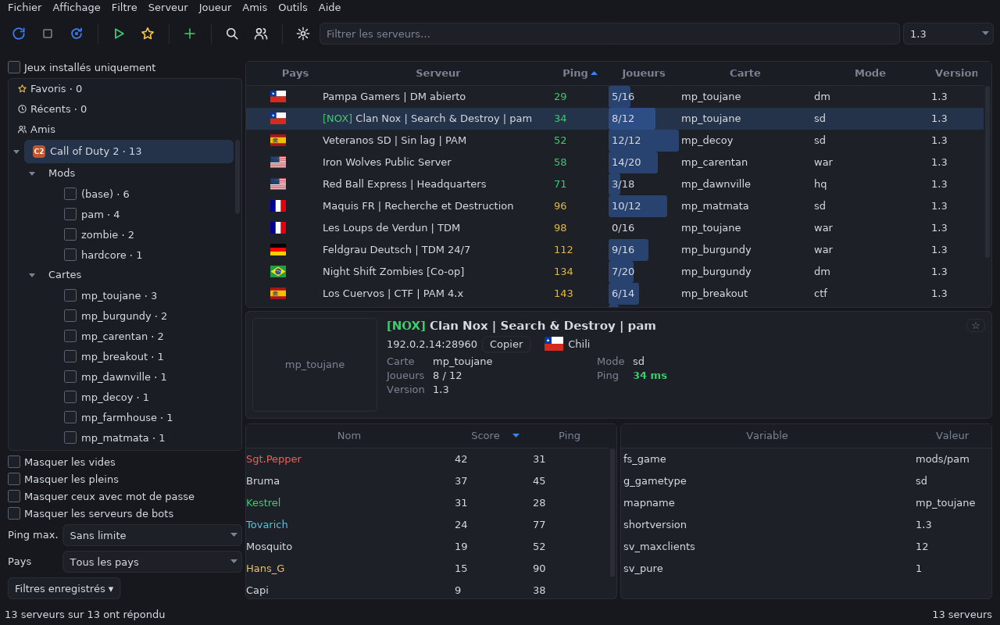
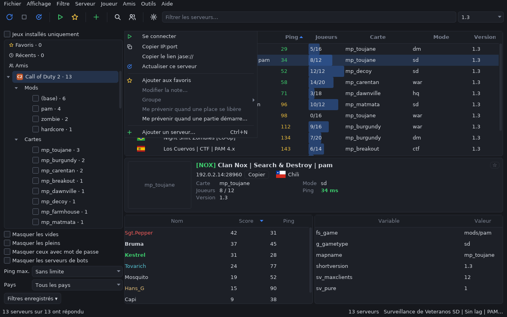
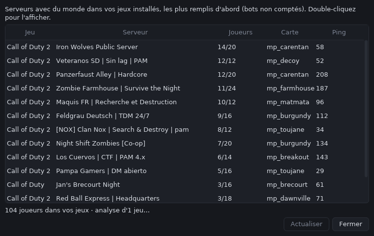
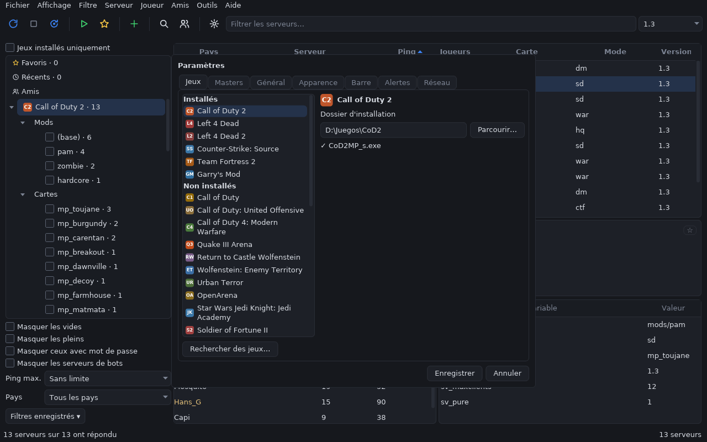

[English](README.md) | [Español](README.es.md) | [Português](README.pt.md) | **Français** | [Deutsch](README.de.md) | [Italiano](README.it.md)

# Jimmy's All Seeing Eye

**Trouvez un serveur pour les jeux classiques que vous aimez toujours, et rejoignez-le d'un double-clic.**

JASE est un navigateur de serveurs gratuit pour Windows dans l'esprit du vieux *All-Seeing Eye*. Choisissez un jeu, voyez qui joue en ce moment et lancez-vous : sans commandes de console, sans copier d'IP.

**[⬇ Télécharger pour Windows](https://github.com/JotaJazz/JASE/releases)** · gratuit et open source (MIT) · AppImage Linux (expérimentale)

## Ce qu'il fait

- 🎮 **36 jeux classiques au même endroit** : Call of Duty, Quake, Unreal Tournament, Counter-Strike, Medal of Honor, Battlefield 1942 et bien d'autres.
- ⚡ **Double-cliquez pour jouer** : JASE trouve vos jeux installés et les lance déjà connectés.
- 🔎 **Trouvez vite le bon serveur** : filtrez par ping, pays, carte ou mod ; masquez les serveurs vides, pleins ou avec seulement des bots.
- ⭐ **Favoris et serveurs récents**, avec groupes et notes, pour garder le serveur de votre clan à un clic.
- 🎨 **Onze thèmes**, de Classique 98 et Windows XP à Terminal et Synthwave ; en français, anglais, espagnol, portugais, allemand et italien.

## Plus que le vieil ASE

- 🔗 **Liens jase://** : clic droit sur un serveur → *Copier le lien jase://* et collez-le sur Discord ou un forum. Qui l'ouvre voit JASE interroger ce serveur et proposer de le rejoindre.
- 📋 **Collez n'importe quoi** : `Ctrl+V` avec une adresse, une liste ou un bout de chat, et JASE ajoute tous les serveurs ; *Détecter* trouve de quel jeu il s'agit.
- 🔔 **Il vous dit quand jouer** : une place libre sur un serveur plein, une partie qui se remplit, un ami qui se connecte.
- 👥 **En jeu maintenant** : une seule liste avec tous les serveurs occupés de tous vos jeux, les plus pleins d'abord.
- 🧑‍🤝‍🧑 **Amis et recherche de joueurs** : cherchez un joueur dans les listes chargées ; vos amis apparaissent en gras.
- 📈 **Historique de fréquentation** : favoris et récents affichent leur moyenne de joueurs par heure.
- 🛠 **Pour les admins** : une console RCON avec historique.
- 🏠 **LAN parties** : trouve les serveurs de votre réseau local sans master.
- ⚙️ **À votre façon** : réorganisez la barre d'outils, choisissez vos alertes, utilisez un proxy HTTP ou SOCKS.
- 💻 **Ligne de commande** : `jase-cli` fait les mêmes requêtes avec une sortie JSON.
- 🔄 **Toujours à jour** : il se met à jour tout seul, et les nouveaux masters arrivent sans nouvelle version.

<table>
<tr>
<td></td>
<td></td>
</tr>
<tr>
<td></td>
<td></td>
</tr>
</table>

## Jeux pris en charge

| Famille | Jeux |
|---|---|
| Call of Duty | Call of Duty, Call of Duty: United Offensive, Call of Duty 2, Call of Duty 4: Modern Warfare |
| id Tech / Quake | Quake II, Quake III Arena, Return to Castle Wolfenstein, Wolfenstein: Enemy Territory, Star Wars Jedi Knight II: Jedi Outcast, Star Wars Jedi Knight: Jedi Academy, Soldier of Fortune II, D-Day: Normandy |
| Libres et communautaires | Urban Terror, OpenArena, Xonotic, Warsow, Warfork, Tremulous, Smokin' Guns, Zandronum (Doom) |
| Unreal | Unreal Tournament (UT99), Tactical Ops, Unreal Tournament 2004 |
| Autres | Medal of Honor: Allied Assault, Medal of Honor: Spearhead, Medal of Honor: Breakthrough (aussi OpenMoHAA), Battlefield 1942 |
| Valve | Counter-Strike 1.6, Half-Life Deathmatch, Day of Defeat, Team Fortress Classic, Counter-Strike: Source\*, Team Fortress 2\*, Left 4 Dead\*, Left 4 Dead 2\*, Garry's Mod\* |

\* Nécessite une [clé gratuite de l'API web Steam](docs/guia/user-guide.md#steam-games-and-the-steam-web-api-key) (en anglais ; HL DM, DoD et TFC aussi).

## Apportez votre jeu ou votre master

Votre jeu manque, ou votre communauté fait tourner son propre serveur master ? Aidez-nous à l'ajouter :

- **Un master** : ouvrez une [issue](https://github.com/JotaJazz/JASE/issues) avec le jeu et le `hôte:port` du master. Dès qu'il répond à une vraie requête, il entre dans [`masters.json`](masters.json) et chaque JASE le reçoit en moins d'un jour, sans nouvelle version. En attendant, vous pouvez l'ajouter vous-même dans *Outils → Paramètres → Masters*.
- **Un jeu** : ouvrez une [issue](https://github.com/JotaJazz/JASE/issues) avec son nom, le master qu'il utilise et un serveur pour tester. Si vous codez, le [guide pas à pas](docs/desarrollo/agregar-juego.md) (en espagnol) indique ce qu'une pull request demande : une vraie requête, des réponses enregistrées et des tests.

## Pour commencer

1. **Téléchargez** l'installeur (`JASE-<version>-setup.exe`) depuis [Releases](https://github.com/JotaJazz/JASE/releases). Pas envie d'installer ? Prenez le `.zip` portable.
2. **Lancez-le.** Windows peut vous avertir car l'application n'est pas signée : cliquez sur **Informations complémentaires → Exécuter quand même**.
3. **Laissez-le trouver vos jeux** au premier lancement (ou choisissez les dossiers dans *Outils → Paramètres*).
4. **Choisissez un jeu, appuyez sur `F5` et double-cliquez sur un serveur.** C'est tout.

## En savoir plus

- 📖 [Guide d'utilisation](docs/guia/user-guide.md) (en anglais) : toutes les fonctions, raccourcis, paramètres et où vos données sont stockées.
- 🛰 [Jeux et masters](docs/guia/games-and-masters.md) (en anglais) : quels serveurs master utilise chaque jeu, versions et notes par jeu.
- 💻 [Ligne de commande (`jase-cli`)](docs/cli.md) : les mêmes requêtes sans interface, avec une sortie JSON.
- 🛠 [Lancer depuis le code et contribuer](docs/README.md) (en espagnol).

## À propos

Je fais JASE par nostalgie des vieux jeux et des serveurs où nous jouions. Une bonne partie du code, des tests et de la documentation est écrite avec [Claude Code](https://claude.com/claude-code), l'assistant de programmation IA d'Anthropic ; je relis, j'essaie et je décide de ce qui entre.

Licence MIT ; voir [LICENSE](LICENSE). Données de pays par [DB-IP](https://db-ip.com) (CC BY 4.0), drapeaux par [flag-icons](https://github.com/lipis/flag-icons) (MIT), construit avec Iced, tokio et les crates de `licenses/THIRD-PARTY.txt`. Disposition des menus inspirée d'OpenASE. Merci aux communautés qui gardent ces jeux en vie : 333networks, OpenSpy, jkhub, 1fxmod, dpmaster et cs16.net.
