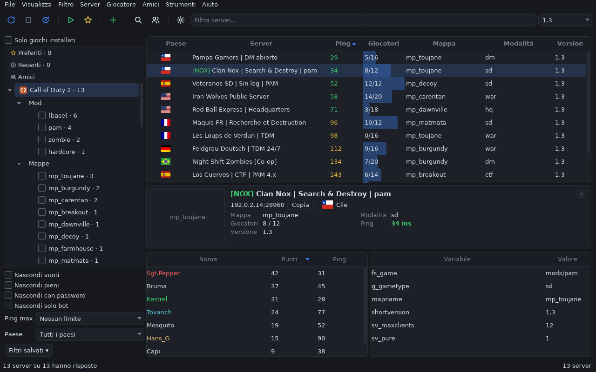
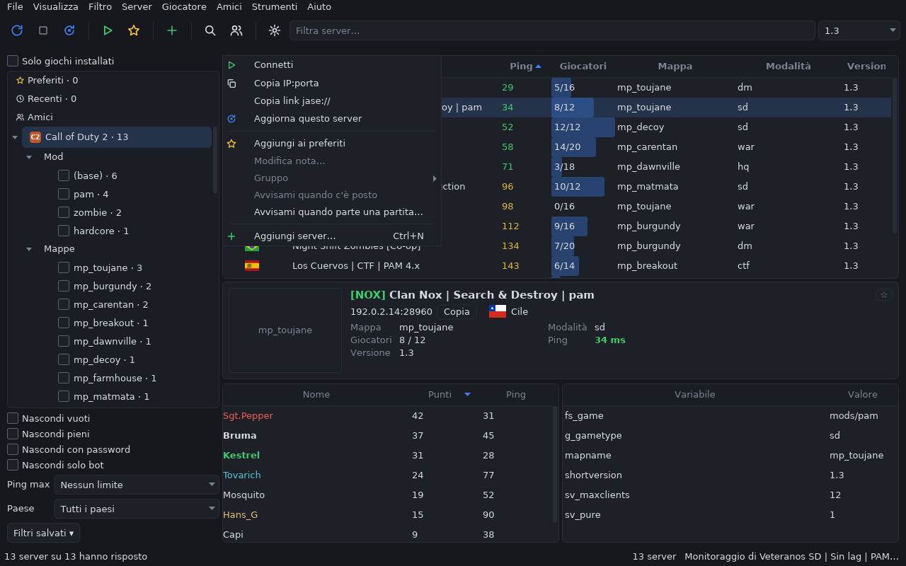
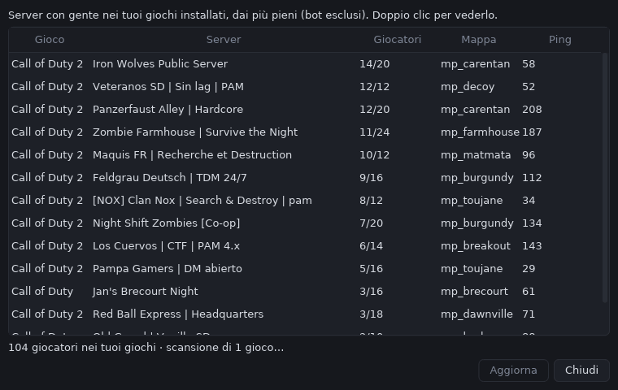
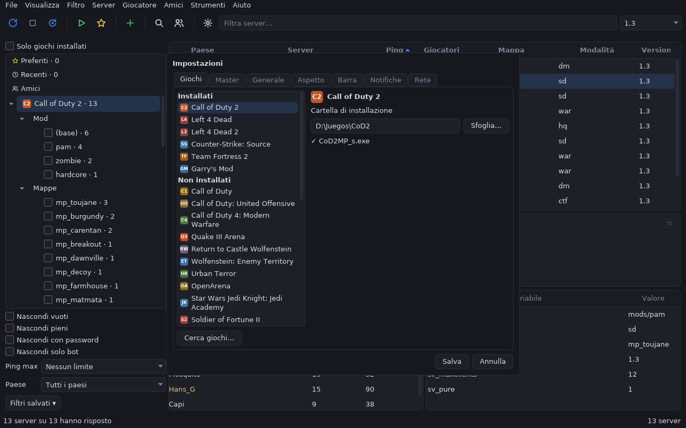

[English](README.md) | [Español](README.es.md) | [Português](README.pt.md) | [Français](README.fr.md) | [Deutsch](README.de.md) | **Italiano**

# Jimmy's All Seeing Eye

**Trova un server per i classici che ami ancora, ed entra con un doppio clic.**

JASE è un browser di server gratuito per Windows nello spirito del vecchio *All-Seeing Eye*. Scegli un gioco, guarda chi sta giocando adesso ed entra: niente comandi da console, niente IP da copiare.

**[⬇ Scarica per Windows](https://github.com/JotaJazz/JASE/releases)** · gratuito e open source (MIT) · AppImage per Linux (sperimentale)

## Cosa fa

- 🎮 **36 giochi classici in un solo posto**: Call of Duty, Quake, Unreal Tournament, Counter-Strike, Medal of Honor, Battlefield 1942 e molti altri.
- ⚡ **Doppio clic per giocare**: JASE trova i tuoi giochi installati e li avvia già connessi.
- 🔎 **Trova subito il server giusto**: filtra per ping, paese, mappa o mod; nascondi i server vuoti, pieni o con soli bot.
- ⭐ **Preferiti e server recenti**, con gruppi e note, così il server del tuo clan è sempre a un clic.
- 🎨 **Undici temi**, da Classico 98 e Windows XP a Terminal e Synthwave; in italiano, inglese, spagnolo, portoghese, francese e tedesco.

## Più del vecchio ASE

- 🔗 **Link jase://**: clic destro su un server → *Copia link jase://* e incollalo su Discord o in un forum. Chi lo apre vede JASE interrogare quel server e chiedere se vuole entrare.
- 📋 **Incolla quello che vuoi**: `Ctrl+V` con un indirizzo, un elenco o un pezzo di chat, e JASE aggiunge tutti i server; *Rileva* scopre di che gioco sono.
- 🔔 **Ti dice quando giocare**: un posto libero su un server pieno, una partita che si riempie, un amico che si collega.
- 👥 **Si gioca ora**: un unico elenco con tutti i server popolati di tutti i tuoi giochi, i più pieni per primi.
- 🧑‍🤝‍🧑 **Amici e ricerca giocatori**: cerca un giocatore negli elenchi caricati; gli amici appaiono in grassetto.
- 📈 **Storico di affollamento**: preferiti e recenti mostrano la media dei giocatori per ora.
- 🛠 **Per gli admin**: una console RCON con cronologia.
- 🏠 **LAN party**: trova i server della tua rete locale senza master.
- ⚙️ **A modo tuo**: riordina la barra degli strumenti, scegli le notifiche, usa un proxy HTTP o SOCKS.
- 💻 **Riga di comando**: `jase-cli` fa le stesse interrogazioni con output JSON.
- 🔄 **Sempre aggiornato**: si aggiorna da solo, e i nuovi master arrivano senza una nuova versione.

<table>
<tr>
<td></td>
<td></td>
</tr>
<tr>
<td></td>
<td></td>
</tr>
</table>

## Giochi supportati

| Famiglia | Giochi |
|---|---|
| Call of Duty | Call of Duty, Call of Duty: United Offensive, Call of Duty 2, Call of Duty 4: Modern Warfare |
| id Tech / Quake | Quake II, Quake III Arena, Return to Castle Wolfenstein, Wolfenstein: Enemy Territory, Star Wars Jedi Knight II: Jedi Outcast, Star Wars Jedi Knight: Jedi Academy, Soldier of Fortune II, D-Day: Normandy |
| Liberi e comunitari | Urban Terror, OpenArena, Xonotic, Warsow, Warfork, Tremulous, Smokin' Guns, Zandronum (Doom) |
| Unreal | Unreal Tournament (UT99), Tactical Ops, Unreal Tournament 2004 |
| Altri | Medal of Honor: Allied Assault, Medal of Honor: Spearhead, Medal of Honor: Breakthrough (anche OpenMoHAA), Battlefield 1942 |
| Valve | Counter-Strike 1.6, Half-Life Deathmatch, Day of Defeat, Team Fortress Classic, Counter-Strike: Source\*, Team Fortress 2\*, Left 4 Dead\*, Left 4 Dead 2\*, Garry's Mod\* |

\* Richiede una [chiave gratuita della Steam Web API](docs/guia/user-guide.md#steam-games-and-the-steam-web-api-key) (in inglese; anche HL DM, DoD e TFC).

## Porta il tuo gioco o il tuo master

Manca il tuo gioco, o la tua community gestisce un proprio master server? Aiutaci ad aggiungerlo:

- **Un master**: apri una [issue](https://github.com/JotaJazz/JASE/issues) con il gioco e `host:porta` del master. Appena risponde a un'interrogazione reale entra in [`masters.json`](masters.json), e ogni JASE lo riceve entro un giorno, senza nuova versione. Nel frattempo puoi aggiungerlo tu in *Strumenti → Impostazioni → Master*.
- **Un gioco**: apri una [issue](https://github.com/JotaJazz/JASE/issues) con il nome, il master che usa e un server da provare. Se programmi, la [guida passo passo](docs/desarrollo/agregar-juego.md) (in spagnolo) spiega cosa serve a una pull request: un'interrogazione reale, risposte registrate e test.

## Per iniziare

1. **Scarica** l'installer (`JASE-<versione>-setup.exe`) da [Releases](https://github.com/JotaJazz/JASE/releases). Preferisci non installare? Prendi lo `.zip` portatile.
2. **Avvialo.** Windows potrebbe avvisarti perché l'app non è firmata: clicca **Ulteriori informazioni → Esegui comunque**.
3. **Lascia che trovi i tuoi giochi** al primo avvio (o scegli le cartelle in *Strumenti → Impostazioni*).
4. **Scegli un gioco, premi `F5` e fai doppio clic su un server.** Tutto qui.

## Per saperne di più

- 📖 [Guida utente](docs/guia/user-guide.md) (in inglese): tutte le funzioni, scorciatoie, impostazioni e dove sono salvati i tuoi dati.
- 🛰 [Giochi e master](docs/guia/games-and-masters.md) (in inglese): quali master server usa ogni gioco, versioni e note per gioco.
- 💻 [Riga di comando (`jase-cli`)](docs/cli.md): le stesse interrogazioni senza interfaccia, con output JSON.
- 🛠 [Avviare dal codice e contribuire](docs/README.md) (in spagnolo).

## Informazioni

Faccio JASE per nostalgia dei vecchi giochi e dei server su cui giocavamo. Gran parte del codice, dei test e della documentazione è scritta con [Claude Code](https://claude.com/claude-code), l'assistente di programmazione IA di Anthropic; io rivedo, provo e decido cosa entra.

Licenza MIT; vedi [LICENSE](LICENSE). Dati dei paesi di [DB-IP](https://db-ip.com) (CC BY 4.0), bandiere di [flag-icons](https://github.com/lipis/flag-icons) (MIT), realizzato con Iced, tokio e i crate di `licenses/THIRD-PARTY.txt`. Disposizione dei menu ispirata a OpenASE. Grazie alle community che tengono vivi questi giochi: 333networks, OpenSpy, jkhub, 1fxmod, dpmaster e cs16.net.
