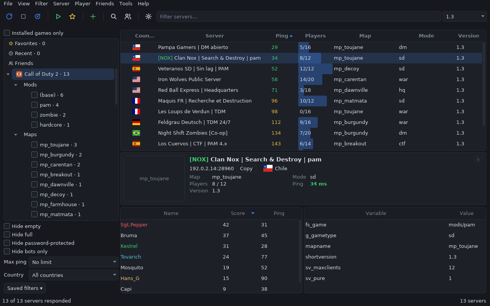
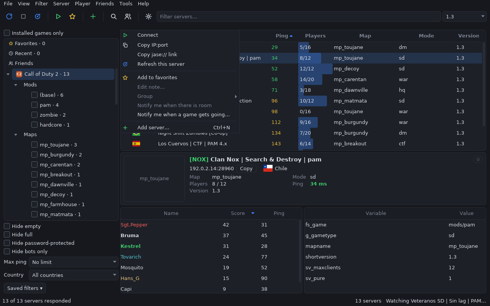
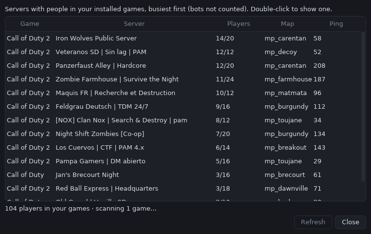
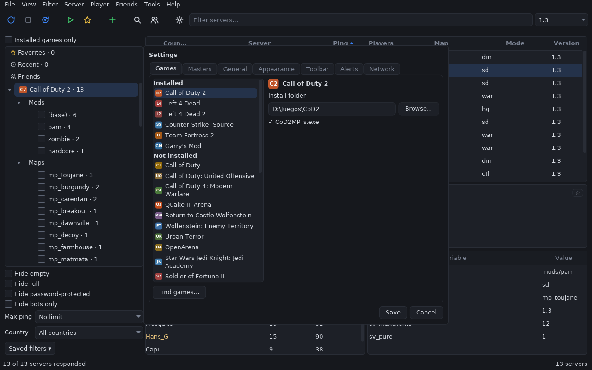

**English** | [Español](README.es.md) | [Português](README.pt.md) | [Français](README.fr.md) | [Deutsch](README.de.md) | [Italiano](README.it.md)

# Jimmy's All Seeing Eye

**Find a server for the classic games you still love, and join it with a double click.**

JASE is a free server browser for Windows in the spirit of the old *All-Seeing Eye*. Pick a game, see who's playing right now, and jump in: no console commands, no copying IPs.

**[⬇ Download for Windows](https://github.com/JotaJazz/JASE/releases)** · free and open source (MIT) · Linux AppImage (experimental)

## What it does

- 🎮 **36 classic games in one place**: Call of Duty, Quake, Unreal Tournament, Counter-Strike, Medal of Honor, Battlefield 1942 and many more.
- ⚡ **Double-click to play**: JASE finds your installed games and launches them already connected.
- 🔎 **Find the right server fast**: filter by ping, country, map or mod; hide empty, full or bots-only servers.
- ⭐ **Favorites and recent servers**, with groups and notes, so your clan's server is always one click away.
- 🎨 **Eleven themes**, from Classic 98 and Windows XP to Terminal and Synthwave; in English, Spanish, Portuguese, French, German and Italian.

## More than the old ASE

- 🔗 **jase:// links**: right-click a server → *Copy jase:// link* and paste it on Discord or a forum. Whoever opens it gets JASE querying that server and asking to join.
- 📋 **Paste anything**: `Ctrl+V` an address, a list of them or a chunk of chat text, and JASE adds every server; *Detect* works out which game it is.
- 🔔 **It tells you when to play**: a free slot on a full server, a match filling up, a friend coming online.
- 👥 **Playing now**: one list with every busy server across all your games, busiest first.
- 🧑‍🤝‍🧑 **Friends and player search**: find a player across the loaded lists; friends show in bold.
- 📈 **Occupancy history**: favorites and recent servers chart their average players per hour.
- 🛠 **For admins**: an RCON console with history.
- 🏠 **LAN parties**: finds servers on your local network without a master.
- ⚙️ **Your way**: reorder the toolbar, choose your alerts, use an HTTP or SOCKS proxy.
- 💻 **Command line**: `jase-cli` runs the same queries with JSON output.
- 🔄 **Stays up to date**: it updates itself, and new masters reach you without a new version.

<table>
<tr>
<td></td>
<td></td>
</tr>
<tr>
<td></td>
<td></td>
</tr>
</table>

## Supported games

| Family | Games |
|---|---|
| Call of Duty | Call of Duty, Call of Duty: United Offensive, Call of Duty 2, Call of Duty 4: Modern Warfare |
| id Tech / Quake | Quake II, Quake III Arena, Return to Castle Wolfenstein, Wolfenstein: Enemy Territory, Star Wars Jedi Knight II: Jedi Outcast, Star Wars Jedi Knight: Jedi Academy, Soldier of Fortune II, D-Day: Normandy |
| Free & community | Urban Terror, OpenArena, Xonotic, Warsow, Warfork, Tremulous, Smokin' Guns, Zandronum (Doom) |
| Unreal | Unreal Tournament (UT99), Tactical Ops, Unreal Tournament 2004 |
| Others | Medal of Honor: Allied Assault, Medal of Honor: Spearhead, Medal of Honor: Breakthrough (also OpenMoHAA), Battlefield 1942 |
| Valve | Counter-Strike 1.6, Half-Life Deathmatch, Day of Defeat, Team Fortress Classic, Counter-Strike: Source\*, Team Fortress 2\*, Left 4 Dead\*, Left 4 Dead 2\*, Garry's Mod\* |

\* Needs a free [Steam Web API key](docs/guia/user-guide.md#steam-games-and-the-steam-web-api-key) (HL DM, DoD and TFC too).

## Bring your game or your master

Is your game missing, or does your community run its own master server? Help us add it:

- **A master**: open an [issue](https://github.com/JotaJazz/JASE/issues) with the game and the master's `host:port`. Once it answers a real query it goes into [`masters.json`](masters.json), and every JASE picks it up within a day, no new version needed. Until then you can add it yourself in *Tools → Settings → Masters*.
- **A game**: open an [issue](https://github.com/JotaJazz/JASE/issues) with its name, the master it uses and a server to try. If you code, the [step-by-step guide](docs/desarrollo/agregar-juego.md) (in Spanish) shows what a pull request needs: a real probe, recorded answers and tests.

## Get started

1. **Download** the installer (`JASE-<version>-setup.exe`) from [Releases](https://github.com/JotaJazz/JASE/releases). Prefer no install? Grab the portable `.zip`.
2. **Run it.** Windows may warn you because the app is not code-signed: click **More info → Run anyway**.
3. **Let it find your games** on first launch (or set the folders in *Tools → Settings*).
4. **Pick a game, press `F5`, double-click a server.** That's it.

## Learn more

- 📖 [User guide](docs/guia/user-guide.md): every feature, shortcuts, settings, where your data is stored.
- 🛰 [Games and masters](docs/guia/games-and-masters.md): which master servers each game uses, versions and per-game notes.
- 💻 [Command line (`jase-cli`)](docs/cli.md): the same queries without a GUI, with JSON output.
- 🛠 [Run from source and contribute](docs/README.md) (in Spanish).

## About

I build JASE out of nostalgia for the old games and the servers we used to play on. Much of the code, tests and docs are written with [Claude Code](https://claude.com/claude-code), Anthropic's AI coding assistant; I review, try out and decide what goes in.

MIT license; see [LICENSE](LICENSE). Country data by [DB-IP](https://db-ip.com) (CC BY 4.0), flags by [flag-icons](https://github.com/lipis/flag-icons) (MIT), built with Iced, tokio and the crates in `licenses/THIRD-PARTY.txt`. Menu layout inspired by OpenASE. Thanks to the communities that keep these games alive: 333networks, OpenSpy, jkhub, 1fxmod, dpmaster and cs16.net.
