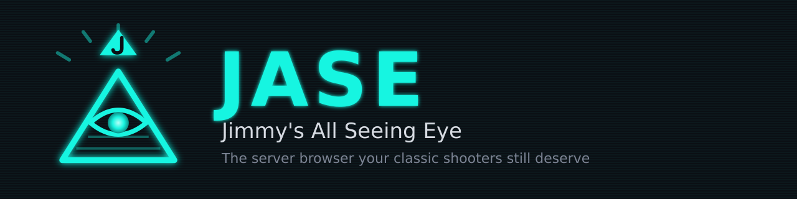
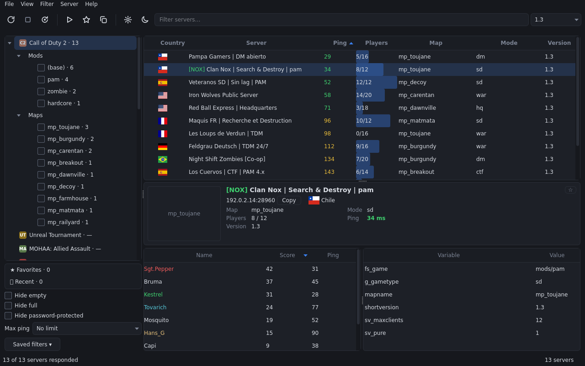

[Español](README.es.md) | **English**



# Jimmy's All Seeing Eye (JASE)

A game server browser in the spirit of the classic *All-Seeing Eye*. It queries the master servers, lists servers with name, map, players, version and ping, and launches the game already connected with a double click.



## Features

- 15 supported games (Medal of Honor counts Spearhead and Breakthrough separately) on three protocols: Quake 3 (Call of Duty, Quake III, Wolfenstein, Jedi Academy, SoF2), GameSpy (Unreal Tournament, Medal of Honor, Battlefield 1942) and Valve (Counter-Strike 1.6).
- Server table with country flags; a server card with map image (from your installed games, optional online download), players and rules.
- Quick filters (hide empty, hide full, hide password-protected, max ping), plus text and version filters.
- Game tree with **Mods** and **Maps** you can tick to filter the table.
- Favorites, queried directly without a master.
- Automatic game detection: Windows registry, Steam libraries and common folders.
- Server passwords stored in the Windows Credential Manager.
- Dark and light themes; English and Spanish interface.

## Supported games

Call of Duty 2, Call of Duty, Call of Duty: United Offensive, Call of Duty 4: Modern Warfare, Quake III Arena, Return to Castle Wolfenstein, Wolfenstein: Enemy Territory, Unreal Tournament (UT99), Medal of Honor: Allied Assault (with Spearhead and Breakthrough, also OpenMoHAA), Star Wars Jedi Knight: Jedi Academy, Soldier of Fortune II, Counter-Strike 1.6 and Battlefield 1942.

Masters were verified on 2026-10-18/19; see [Masters used](#masters-used).
**Half-Life deathmatch is not on the list:** no master returns Half-Life servers.
The executables and connection arguments for Jedi Academy, SoF2, CS 1.6 and BF1942 are still pending verification on Windows.

## Download

Get the latest portable zip from the [Releases page](https://github.com/JotaJazz/JASE/releases). Unzip it anywhere and run the exe; there is no installer.

The exe is not code-signed, so Windows SmartScreen may show a warning the first time. Click **More info → Run anyway**.

## Usage

On first launch JASE offers to find your installed games. You can also open **File → Settings** and set each game's folder by hand (the one containing, per game: `CoD2MP_s.exe` for CoD2, `CoDMP.exe` for CoD, `CoDUOMP.exe` for United Offensive, `iw3mp.exe` for CoD4, `quake3.exe` for Quake III, `WolfMP.exe` for RtCW, `ET.exe` for Enemy Territory, `System\UnrealTournament.exe` for UT99, `MOHAA.exe` for Medal of Honor (see [below](#medal-of-honor-and-openmohaa)), `GameData\jamp.exe` for Jedi Academy, `SoF2MP.exe` for SoF2, `hl.exe` for CS 1.6 or `BF1942.exe` for BF1942).

Pick a game in the left panel, press **Refresh list** (toolbar icon or `F5`) and double-click a server to join.

- **Quick filters** (left panel): *Hide empty*, *Hide full*, *Hide password-protected* and *Max ping*; they combine with the text and version filters and are remembered between sessions.
- **Shortcuts:** `Enter` connects to the selected server, `Ctrl+C` copies its IP:port (both with the table focused), `Ctrl+F` focuses the text filter and `F5` refreshes.
- **Context menu** (right-click a server): Connect, Copy IP:port, Refresh this server and Add/Remove from favorites.
- **Server card:** selecting a server shows its map image, country, players and rules.
- **Favorites:** the star on the card (or the context menu) marks a server as a favorite; **★ Favorites** in the left panel lists them per game, querying them directly (no master) and showing the ones that do not answer as offline.
- **Game tree and toolbar:** the left panel is a tree per game with its **Mods** and **Maps** (ticking them filters the table; *Clear mod/map filters* resets them). The toolbar and menu give access to refresh, stop, connect, favorites, settings and theme; *Find games…* is in the **File** menu.
- **Window:** size, splitters, columns and the last game are remembered.

### Find games

**Find games…** (**File** menu or **File → Settings**) detects installed games in the background: Windows registry, Steam libraries and common folders (`Program Files`, `Games`, `Juegos`…). **Search in folder…** also scans a folder of your choice. Each game is shown as *new*, *already set up* or *saved path not found*. A path that already works is never replaced unless you tick its checkbox, and only ticked rows are applied. On the very first launch, with no games configured, it offers to search once.

### Language

The interface is available in English and Spanish. By default it follows your Windows language; you can pick another one in **File → Settings → Language**. The change takes effect after restarting JASE.

## Masters used

| Game | Master | Protocols / versions |
|---|---|---|
| Call of Duty 2 | `cod2master.activision.com:20710` | 115 = 1.0, 117 = 1.2, 118 = 1.3 |
| Call of Duty | `codmaster.activision.com:20510` | 1 = 1.1, 2 = 1.2, 4 = 1.3, 5 = 1.4, 6 = 1.5 |
| Unreal Tournament | `master.333networks.com:28900`, `master.openspy.net:28900` | 436, 451, 469 |
| Call of Duty: United Offensive | `coduomaster.activision.com:20610` | 21 = 1.41, 22 = 1.51, 24 = 1.51 |
| Call of Duty 4 | `cod4master.activision.com:20810` | 6 = 1.7 (and CoD4X, version "-"), 7 = 1.8, 5 = 1.6, 1 and 8 = 1.0 |
| Quake III Arena | `master.ioquake3.org:27950`, `master.quake3arena.com:27950`, `master.maverickservers.com:27950` | 68 = 1.32 (Q3 1.32e, ioq3 1.36, CNQ3 1.53) |
| Return to Castle Wolfenstein | `wolfmaster.idsoftware.com:27950` | 57, 60 = 1.41 (Wolf 1.0, Wolf 1.41/1.41b, iortcw 1.51) |
| Wolfenstein: Enemy Territory | `etmaster.idsoftware.com:27950`, `master.etlegacy.com:27950` | 84 = 2.60b / ET: Legacy |
| Medal of Honor: Allied Assault | `master.333networks.com:28900`, `master.openspy.net:28900` (gamename `mohaa`) | 1.11 (OpenMoHAA: 1.12+0.8x) |
| Medal of Honor: Spearhead | same (gamename `mohaas`) | 2.15 (OpenMoHAA: 2.16+0.8x) |
| Medal of Honor: Breakthrough | same (gamename `mohaab`) | 2.40 (OpenMoHAA: 2.41+0.8x) |
| Jedi Academy | `master.jkhub.org:29060` | 26 = 1.01 |
| Soldier of Fortune II | `master.1fxmod.org:20110` | 2002 = 1.00, 2004 = 1.03 |
| Counter-Strike 1.6 | `ms.cs16.net:27010` (filter `\gamedir\cstrike`) | GoldSrc (A2S_INFO `I` and `m`), no fixed version list |
| Battlefield 1942 | `master.openspy.net:28900` (gamename `bfield1942`) | v1.61, v1.612 |

CoD, CoD2 and UT were verified on 2026-10-18; the rest (including Jedi Academy, SoF2, CS 1.6 and BF1942) on 2026-10-19, by probing each master per protocol with at most 30 status queries per game (`getstatus`, `\status\`, A2S).

## Technical notes

### Medal of Honor and OpenMoHAA

Set the game folder: the one containing `MOHAA.exe` (Spearhead: `moh_spearhead.exe`; Breakthrough: `moh_breakthrough.exe`) or, with OpenMoHAA, the one containing its launchers. If that folder has the variant's OpenMoHAA launcher (`launch_openmohaa_base.exe` for AA, `launch_openmohaa_spearhead.exe` for Spearhead and `launch_openmohaa_breakthrough.exe` for Breakthrough), JASE uses it even if the folder still has `MOHAA.exe`: choosing an OpenMoHAA folder means choosing OpenMoHAA. Without a launcher the original exe is used; if that is missing too, AA falls back to `openmohaa.exe`. Settings shows the chosen executable (e.g. "✓ launch_openmohaa_base.exe"). The launchers pass the arguments on to `openmohaa.exe`, adding `+set com_target_game N`.

MOHAA is launched like the Quake 3 games: `+password <password> +connect ip:port`. The engine registers the `connect` command and the `password` cvar, and `+…` arguments run at startup (`Com_AddStartupCommands`; see `code/client/cl_main.cpp` and `code/Launcher/launch_main.cpp` in github.com/openmoh/openmohaa).

Probe notes (2026-10-19, 18 `\status\` queries per variant):

- The master lists the query port (12300…); `\status\` carries `hostport` with the game port, normally query port − 97 (12203), which is used as a fallback when missing.
- The three masters mix variants (e.g. AA servers in the Spearhead list), so servers whose `gamename` does not match are discarded.
- MOHAA does not advertise a password in `\status\`: no padlock is shown and JASE does not ask for one. On a password-protected server, type it in the game console (`password <password>`, then `reconnect`).
- GameTracker images: folders `mohaa`, `sh` and `bt`, with the `/` in the map name replaced by `_` (`obj/obj_team2` → `obj_obj_team2`). There is no local image extraction for MOHAA.

### Version column

In Quake III, RtCW and ET the Version column shows the abbreviated `version` cvar (`ioq3 1.36+u2022…/Debian linux…` → `ioq3 1.36`); in the Call of Duty games it shows `shortversion`.

### Discarded in probing

These do not return servers or do not suit the standard client:

- Quake III: protocol 67 (1.31, 2–4 servers) and 71 (new ioq3, almost all OpenArena).
- RtCW: protocols 50 and 59 (15 servers each, almost none answered).
- ET: protocol 83 (the master only returns an empty 0.0.0.0:0 entry) and 82 ("ET 3.00" servers, 14); `master.etlegacy.com` does not answer 82/83.
- CoD4: protocols 2, 3 and 4 (no servers).
- **Half-Life deathmatch:** not added; no master queried returns HL servers.
- **Counter-Strike 1.6** (Valve protocol, probed 2026-10-19): it works through `ms.cs16.net:27010` with the `\gamedir\cstrike` filter (`\appid\10` returns 0 on that master); A2S_INFO confirms the game folder. Valve's masters `hl1master.steampowered.com` and `hl2master.steampowered.com` still have no DNS (CNAMEs to `*.discovery.steamserver.net`, NXDOMAIN on Google and Cloudflare), the old IPs (`208.64.200.39/52/65:27011`) and `master.hlsw.org:27010/27011` do not answer, and `master.csmetahook.com` ignores filters and stops at page 2. It is launched as `hl.exe -game cstrike +password <password> +connect ip:port`.
- **Jedi Academy:** `masterjk3.ravensoft.com` resolves but does not answer and `master.jk3.fun` has no DNS; protocol 25 (1.00) has only 2 servers.
- **SoF2:** `sof2master.ravensoft.com`, `master.sof2.org` and `master.sof2.net` have no DNS; protocol 2003 has no servers.
- **Battlefield 1942:** `master.bf1942.org` returns an encrypted list (enctype other than 0) and `master.333networks.com` an empty one.

### Map images

- **CoD2:** read from the installed game's `.iwd` files (verified). The other Quake 3-family games with `.iwd`/`.pk3` try the same, with no guarantee; this does not apply to Jedi Academy or Soldier of Fortune II. Jedi Academy has no images on GameTracker either.
- **UT99:** generated from the `.unr` files in the game's `Maps` folder.
- **GameTracker (optional, off by default):** in **File → Settings** you can enable downloading images from `image.gametracker.com` for maps that are not installed. They are stored in `%APPDATA%\JimmysASE\cache\maps`. Without this option JASE downloads no images.

### Server country

The **Country** column shows each server's flag (name in the tooltip and the card), and the text filter accepts the country code (`cl`, `br`…). The country is looked up offline from the server's IPv4 in DB-IP's "IP to Country Lite" database. The first time JASE runs (and while the file is missing) it is downloaded once in the background to `%APPDATA%\JimmysASE\cache\dbip-country-lite.csv` (~4.5 MB compressed, ~30 MB on disk). Without a network the column stays empty and only the status bar says so. **Settings → Update country database** downloads it again (DB-IP publishes it monthly).

### Configuration and passwords

- Configuration (game paths, theme, version filter, quick filters, favorites, window and masters) is stored in `%APPDATA%\JimmysASE\config.json`. You can edit it by hand with the app closed; for example, the `masters` key replaces a game's masters (`{"masters": {"ut99": [["master.333networks.com", 28900]]}}`).
- Server passwords are **not** saved in that file: they go to the **Windows Credential Manager** (service `JimmysAllSeeingEye`). You can view or delete them in *Control Panel → Credential Manager → Windows Credentials*.
- Cache in `%APPDATA%\JimmysASE\cache\`: map images (`maps\`) and the country database (`dbip-country-lite.csv`).

## Install and run from source

Requirements: Windows 10/11 and **Python 3.11 or newer for Windows** (from [python.org](https://www.python.org/downloads/windows/); tick "Add python.exe to PATH" and keep the `py` launcher). Python dependencies (installed by `pip install -e .`): PySide6, keyring and Pillow (reads map images from the game files).

From the project folder, in PowerShell:

```powershell
py -m venv .venv
.venv\Scripts\pip install -e .
.venv\Scripts\python -m jase
```

(The `.venv\Scripts\jase` command is also available.) On Linux/WSL it runs for development, but it does not launch games.

### Tests

```powershell
.venv\Scripts\pip install -e ".[dev]"
.venv\Scripts\python -m pytest
```

To check that the real masters answer (queries every listed server; for a light run use `--sample N` and, optionally, game ids):

```powershell
.venv\Scripts\python scripts\probe_masters.py --sample 10 cod2 ut99
.venv\Scripts\python scripts\probe_masters.py
```

## License

MIT; see [LICENSE](LICENSE).

## Credits

- IP to Country Lite by [DB-IP](https://db-ip.com), CC BY 4.0 (https://creativecommons.org/licenses/by/4.0/).
- Flags: [flag-icons](https://github.com/lipis/flag-icons) 7.5.0 by Panayiotis Lipiridis, MIT license (`src/jase/assets/flags/LICENSE`).
- Built with PySide6 (Qt for Python, LGPL-3.0), keyring and Pillow.
- Community masters and projects that keep these games alive: 333networks, OpenSpy, jkhub, 1fxmod and cs16.net.
