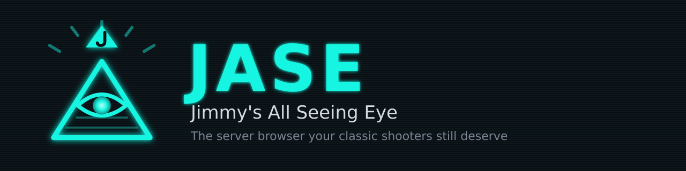
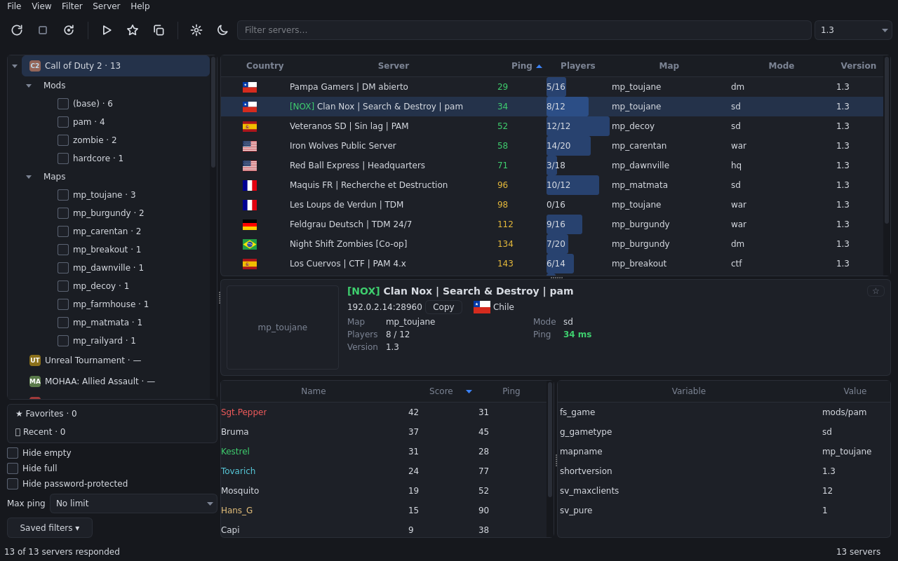

[Español](README.es.md) | **English**

# Jimmy's All Seeing Eye

**Find a server for the classic games you still love, and join it with a double click.**

JASE is a free server browser for Windows in the spirit of the old *All-Seeing Eye*. Pick a game, see who's playing right now, and jump in: no console commands, no copying IPs.

**[⬇ Download for Windows](https://github.com/JotaJazz/JASE/releases)** · free and open source (MIT)

## What it does

- 🎮 **36 classic games in one place**: Call of Duty, Quake, Unreal Tournament, Counter-Strike, Medal of Honor, Battlefield 1942 and many more.
- ⚡ **Double-click to play**: JASE finds your installed games and launches them already connected.
- 🔎 **Find the right server fast**: filter by ping, country, map or mod; hide empty, full or bots-only servers.
- ⭐ **Favorites and recent servers**, with groups and notes, so your clan's server is always one click away.
- 🔔 **Get notified** when a full server has a free slot, when a match is filling up or when a friend comes online.
- 👥 **Playing now**: one list with every busy server across all your games.
- 🏠 **LAN parties**: finds servers on your local network.
- 🎨 **Eleven themes**, from Classic 98 and Windows XP to Terminal and Synthwave; available in English, Spanish, Portuguese, French, German and Italian.

## Supported games

| Family | Games |
|---|---|
| Call of Duty | Call of Duty, Call of Duty: United Offensive, Call of Duty 2, Call of Duty 4: Modern Warfare |
| id Tech / Quake | Quake II, Quake III Arena, Return to Castle Wolfenstein, Wolfenstein: Enemy Territory, Star Wars Jedi Knight II: Jedi Outcast, Star Wars Jedi Knight: Jedi Academy, Soldier of Fortune II, D-Day: Normandy |
| Free & community | Urban Terror, OpenArena, Xonotic, Warsow, Warfork, Tremulous, Smokin' Guns, Zandronum (Doom) |
| Unreal | Unreal Tournament (UT99), Tactical Ops, Unreal Tournament 2004 |
| Others | Medal of Honor: Allied Assault, Medal of Honor: Spearhead, Medal of Honor: Breakthrough (also OpenMoHAA), Battlefield 1942 |
| Valve | Counter-Strike 1.6, Half-Life Deathmatch, Day of Defeat, Team Fortress Classic, Counter-Strike: Source\*, Team Fortress 2\*, Left 4 Dead\*, Left 4 Dead 2\*, Garry's Mod\* |

\* Needs a free [Steam Web API key](docs/guia/user-guide.md#steam-games-and-the-steam-web-api-key) (HL DM, DoD and TFC too).

Missing your game? [Open an issue](https://github.com/JotaJazz/JASE/issues).

## Get started

1. **Download** the installer (`JASE-<version>-setup.exe`) from [Releases](https://github.com/JotaJazz/JASE/releases). Prefer no install? Grab the portable `.zip`.
2. **Run it.** Windows may warn you because the app is not code-signed: click **More info → Run anyway**.
3. **Let it find your games** on first launch (or set the folders in *File → Settings*).
4. **Pick a game, press `F5`, double-click a server.** That's it.

JASE tells you when a new version is out and can update itself.

## Learn more

- 📖 [User guide](docs/guia/user-guide.md): every feature, shortcuts, settings, where your data is stored.
- 🛰 [Games and masters](docs/guia/games-and-masters.md): which master servers each game uses, versions and per-game notes.
- 💻 [Command line (`jase-cli`)](docs/cli.md): the same queries without a GUI, with JSON output.
- 🛠 [Run from source and contribute](docs/README.md) (in Spanish).

## About

I build JASE out of nostalgia for the old games and the servers we used to play on. Much of the code, tests and docs are written with [Claude Code](https://claude.com/claude-code), Anthropic's AI coding assistant; I review, try out and decide what goes in.

MIT license; see [LICENSE](LICENSE). Country data by [DB-IP](https://db-ip.com) (CC BY 4.0), flags by [flag-icons](https://github.com/lipis/flag-icons) (MIT), built with PySide6, keyring and Pillow. Thanks to the communities that keep these games alive: 333networks, OpenSpy, jkhub, 1fxmod, dpmaster and cs16.net.
