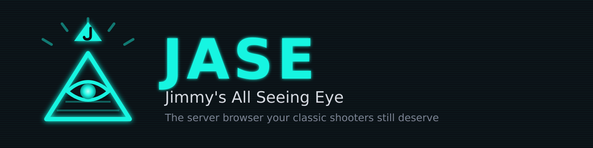
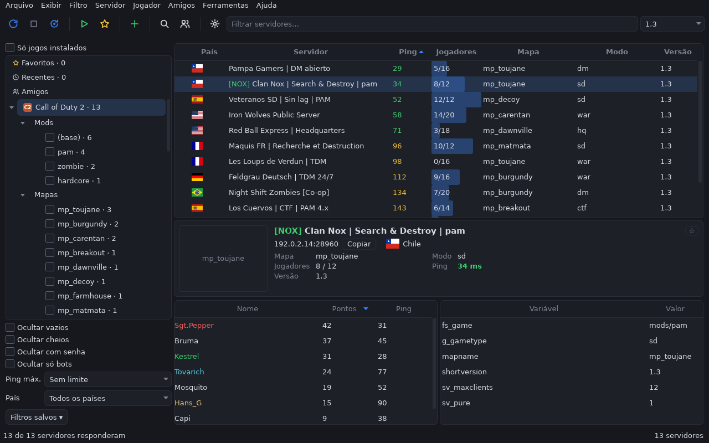
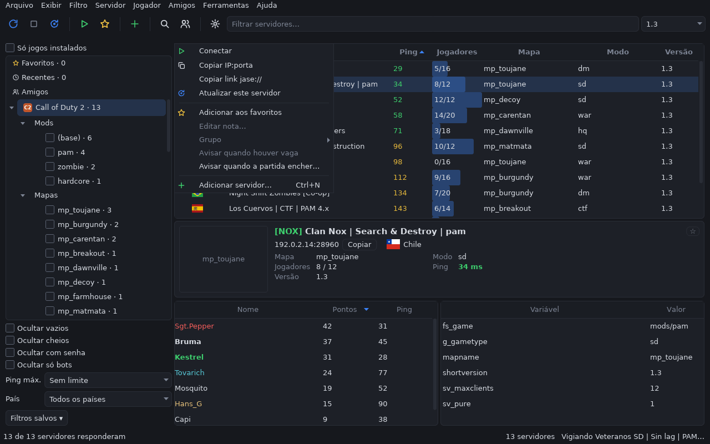
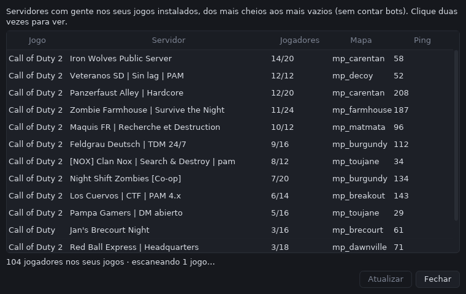
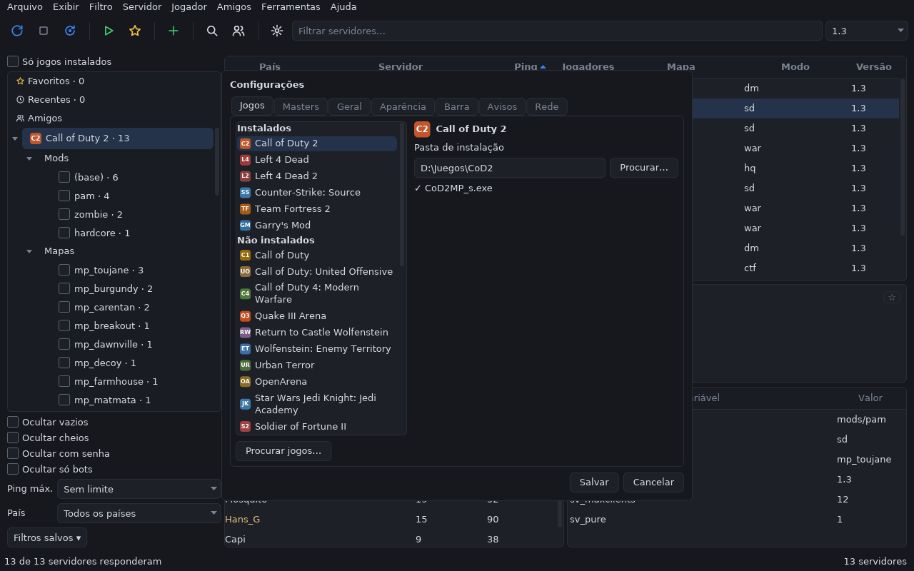

[English](README.md) | [Español](README.es.md) | **Português** | [Français](README.fr.md) | [Deutsch](README.de.md) | [Italiano](README.it.md)

# Jimmy's All Seeing Eye

**Encontre servidor para os jogos clássicos que você ainda adora, e entre com um clique duplo.**

O JASE é um navegador de servidores gratuito para Windows no estilo do velho *All-Seeing Eye*. Escolha um jogo, veja quem está jogando agora e entre: sem comandos de console, sem copiar IPs.

**[⬇ Baixar para Windows](https://github.com/JotaJazz/JASE/releases)** · grátis e de código aberto (MIT) · AppImage para Linux (experimental)

## O que ele faz

- 🎮 **36 jogos clássicos num só lugar**: Call of Duty, Quake, Unreal Tournament, Counter-Strike, Medal of Honor, Battlefield 1942 e muitos outros.
- ⚡ **Clique duplo para jogar**: o JASE encontra seus jogos instalados e os abre já conectados.
- 🔎 **Ache rápido o servidor certo**: filtre por ping, país, mapa ou mod; esconda os vazios, os cheios ou os só com bots.
- ⭐ **Favoritos e servidores recentes**, com grupos e notas, para ter o servidor do seu clã sempre a um clique.
- 🎨 **Onze temas**, de Clássico 98 e Windows XP a Terminal e Synthwave; em português, inglês, espanhol, francês, alemão e italiano.

## Mais que o velho ASE

- 🔗 **Links jase://**: clique direito num servidor → *Copiar link jase://* e cole no Discord ou num fórum. Quem abre o link vê o JASE consultar esse servidor e perguntar se quer entrar.
- 📋 **Cole qualquer coisa**: `Ctrl+V` com um endereço, uma lista ou um trecho de chat, e o JASE adiciona todos os servidores; *Detectar* descobre de que jogo são.
- 🔔 **Ele avisa quando jogar**: uma vaga num servidor cheio, uma partida enchendo, um amigo entrando.
- 👥 **Jogando agora**: uma lista com todos os servidores com gente de todos os seus jogos, os mais cheios primeiro.
- 🧑‍🤝‍🧑 **Amigos e busca de jogadores**: procure um jogador nas listas carregadas; seus amigos aparecem em negrito.
- 📈 **Histórico de ocupação**: favoritos e recentes mostram a média de jogadores por hora.
- 🛠 **Para administradores**: um console RCON com histórico.
- 🏠 **LAN parties**: encontra servidores da sua rede local sem master.
- ⚙️ **Do seu jeito**: reordene a barra de ferramentas, escolha seus avisos, use um proxy HTTP ou SOCKS.
- 💻 **Linha de comando**: o `jase-cli` faz as mesmas consultas com saída JSON.
- 🔄 **Sempre atualizado**: ele se atualiza sozinho, e masters novos chegam sem versão nova.

<table>
<tr>
<td></td>
<td></td>
</tr>
<tr>
<td></td>
<td></td>
</tr>
</table>

## Jogos suportados

| Família | Jogos |
|---|---|
| Call of Duty | Call of Duty, Call of Duty: United Offensive, Call of Duty 2, Call of Duty 4: Modern Warfare |
| id Tech / Quake | Quake II, Quake III Arena, Return to Castle Wolfenstein, Wolfenstein: Enemy Territory, Star Wars Jedi Knight II: Jedi Outcast, Star Wars Jedi Knight: Jedi Academy, Soldier of Fortune II, D-Day: Normandy |
| Livres e comunitários | Urban Terror, OpenArena, Xonotic, Warsow, Warfork, Tremulous, Smokin' Guns, Zandronum (Doom) |
| Unreal | Unreal Tournament (UT99), Tactical Ops, Unreal Tournament 2004 |
| Outros | Medal of Honor: Allied Assault, Medal of Honor: Spearhead, Medal of Honor: Breakthrough (também OpenMoHAA), Battlefield 1942 |
| Valve | Counter-Strike 1.6, Half-Life Deathmatch, Day of Defeat, Team Fortress Classic, Counter-Strike: Source\*, Team Fortress 2\*, Left 4 Dead\*, Left 4 Dead 2\*, Garry's Mod\* |

\* Precisa de uma [chave gratuita da API web do Steam](docs/guia/user-guide.md#steam-games-and-the-steam-web-api-key) (em inglês; também HL DM, DoD e TFC).

## Traga seu jogo ou seu master

Seu jogo não está aqui, ou sua comunidade tem seu próprio servidor master? Ajude a adicioná-lo:

- **Um master**: abra uma [issue](https://github.com/JotaJazz/JASE/issues) com o jogo e o `host:porta` do master. Quando ele responde a uma sondagem real, entra no [`masters.json`](masters.json), e todo JASE o recebe em menos de um dia, sem versão nova. Enquanto isso, você mesmo pode adicioná-lo em *Ferramentas → Configurações → Masters*.
- **Um jogo**: abra uma [issue](https://github.com/JotaJazz/JASE/issues) com o nome, o master que ele usa e um servidor para testar. Se você programa, o [guia passo a passo](docs/desarrollo/agregar-juego.md) (em espanhol) mostra o que um pull request precisa: uma sondagem real, respostas gravadas e testes.

## Começando

1. **Baixe** o instalador (`JASE-<versão>-setup.exe`) em [Releases](https://github.com/JotaJazz/JASE/releases). Prefere não instalar? Pegue o `.zip` portátil.
2. **Abra.** O Windows pode avisar porque o app não é assinado: clique em **Mais informações → Executar assim mesmo**.
3. **Deixe-o encontrar seus jogos** na primeira vez (ou escolha as pastas em *Ferramentas → Configurações*).
4. **Escolha um jogo, aperte `F5` e dê um clique duplo num servidor.** Pronto.

## Saiba mais

- 📖 [Guia do usuário](docs/guia/user-guide.md) (em inglês): todas as funções, atalhos, configurações e onde seus dados ficam.
- 🛰 [Jogos e masters](docs/guia/games-and-masters.md) (em inglês): que servidores master cada jogo usa, versões e notas por jogo.
- 💻 [Linha de comando (`jase-cli`)](docs/cli.md): as mesmas consultas sem interface, com saída JSON.
- 🛠 [Rodar a partir do código e colaborar](docs/README.md) (em espanhol).

## Sobre

Faço o JASE por nostalgia dos jogos antigos e dos servidores onde jogávamos. Boa parte do código, dos testes e da documentação é escrita com o [Claude Code](https://claude.com/claude-code), o assistente de programação com IA da Anthropic; eu reviso, testo e decido o que entra.

Licença MIT; veja [LICENSE](LICENSE). Dados de países do [DB-IP](https://db-ip.com) (CC BY 4.0), bandeiras do [flag-icons](https://github.com/lipis/flag-icons) (MIT), feito com Iced, tokio e os crates de `licenses/THIRD-PARTY.txt`. Disposição dos menus inspirada no OpenASE. Obrigado às comunidades que mantêm estes jogos vivos: 333networks, OpenSpy, jkhub, 1fxmod, dpmaster e cs16.net.
